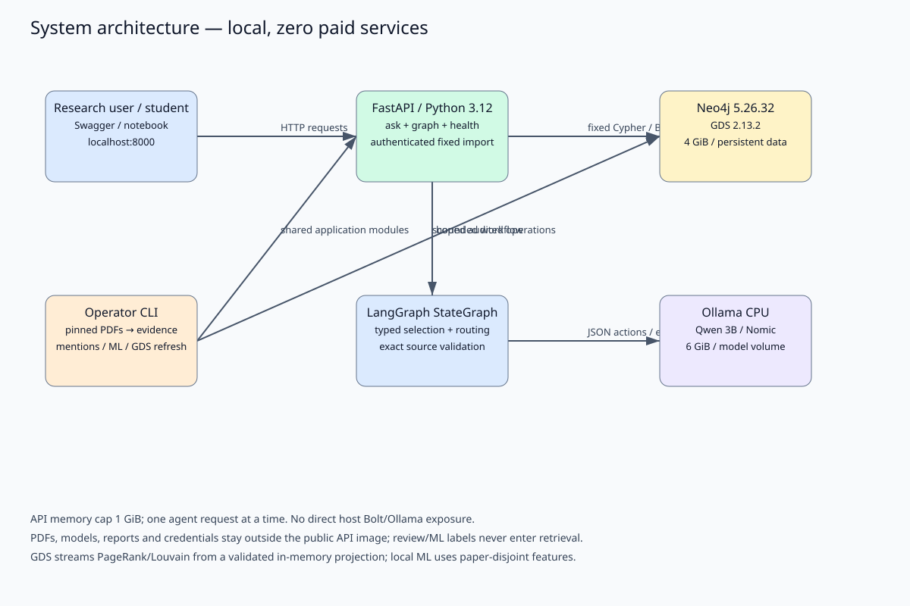
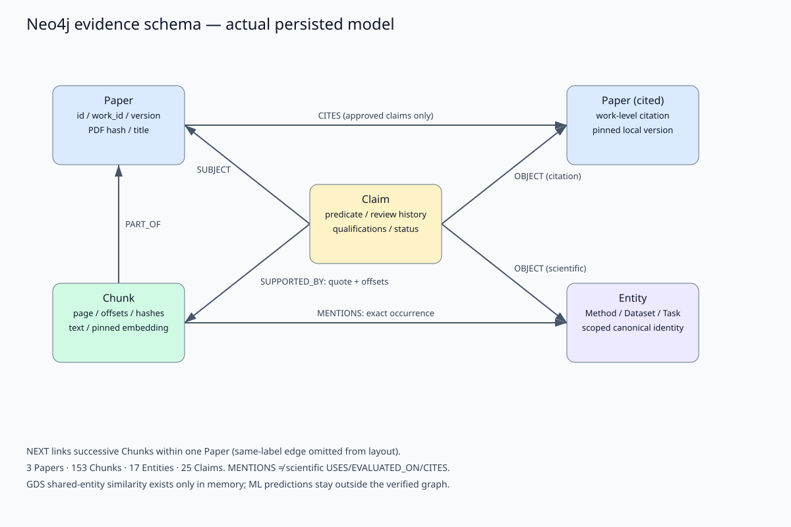
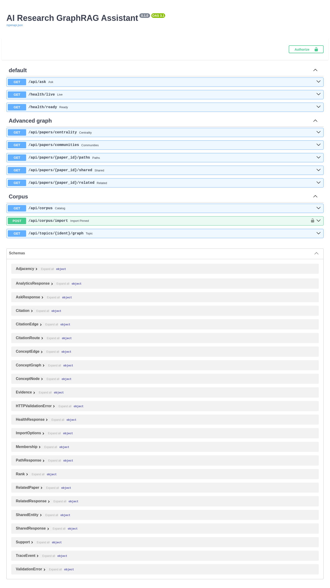
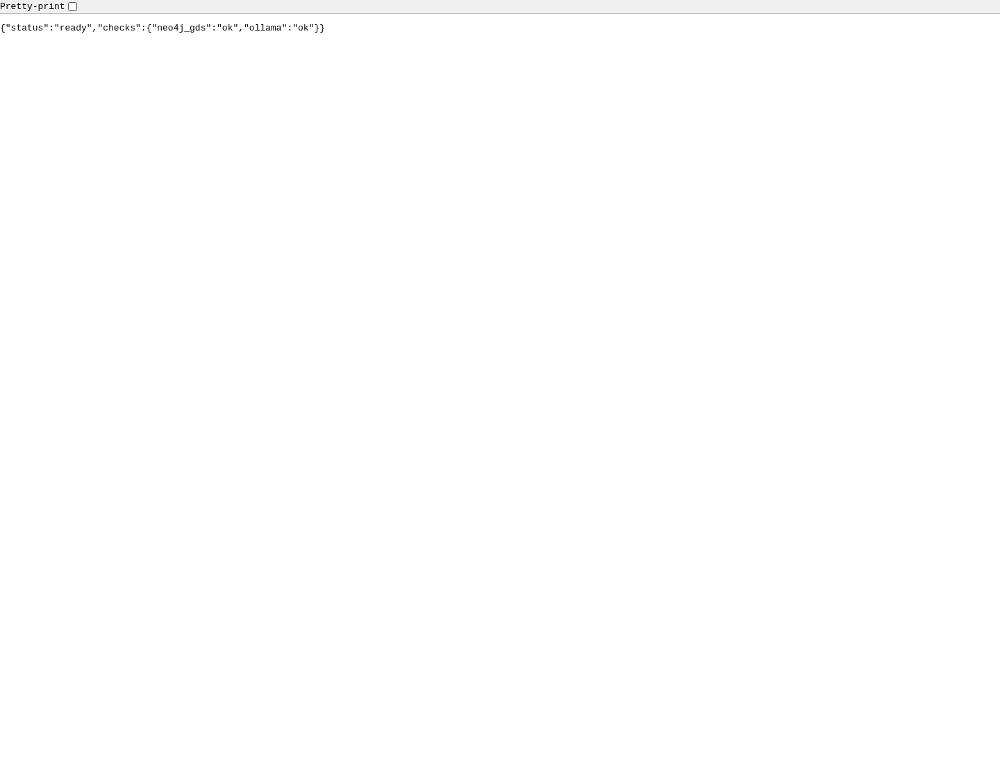

# AI Research GraphRAG Assistant — Project 8, Level 3+

[](https://github.com/NeelSabharwal/GraphDBproject-NeelSabharwal-FabriceAfopa/actions/workflows/quality.yml)

[](docs/FINAL_VALIDATION.md#final-acceptance--2026-11-02)
[](https://github.com/NeelSabharwal/GraphDBproject-NeelSabharwal-FabriceAfopa/actions/runs/41487540210/job/125421711774)

The quality badge follows `main` in this repository. The other two badges are dated
measurements, not live build/coverage services. The repository is private: sign in
with repository access to view CI links; the GitHub badge may be unavailable to anonymous
viewers. **Merged-main CI verified November 2, 2026:** lint and unit/API jobs passed
at `b782bbf` ([run](https://github.com/NeelSabharwal/GraphDBproject-NeelSabharwal-FabriceAfopa/actions/runs/41487540210)). The historical October 23 deadline has passed; no extension/submission is claimed.

This zero-paid-services application helps students inspect AI research papers through
source-grounded answers, directed citation paths, shared datasets/methods, and graph
analytics. It runs Neo4j/GDS, FastAPI and local Ollama under Docker Compose. The corpus
is deliberately three pinned papers: DPR, RAG and GraphRAG. Larger counts in historical
plans are targets, not achieved data.

## What works, and what the results mean

- Provenance-aware PDF ingestion, exact source spans, human review histories and
  bounded, model-directed LangGraph tools. Answers expose quotations and actual tool traces.
- 3 Papers, 153 Chunks, 17 Entities, 25 Claims (22 approved / 3 pending), two verified
  CITES edges and 148 MENTIONS. Every Chunk retains a pinned embedding.
- A real GraphRAG → RAG → DPR citation path; four shared named datasets between DPR/RAG.
- Five advanced graph endpoints, weighted PageRank and Louvain, source-validation guards
  and measured EXPLAIN/PROFILE optimization.
- An authenticated fixed-corpus import endpoint and bounded concept exploration.
- A reproducible graph-feature ML pilot. **Logistic accuracy 0/5, macro-F1 0; majority
  baseline 3/5, macro-F1 .375.** The failed held-out result is retained, not tuned away.
- Local tests/lint, a real executable notebook, editable diagrams and genuine screenshots.
  See [actual validation](docs/FINAL_VALIDATION.md) and [all 100 rubric points](docs/FINAL_RUBRIC_AUDIT.md).

Vector search finds similar passages; it cannot itself establish a directed bibliography
chain, a shared reviewed dataset identity, or a multi-chunk source assertion. The graph
makes these relationships queryable with their review and provenance constraints. It
also adds complexity and selective extraction coverage; no retrieval-quality superiority
or large-corpus generalization is established by these three papers.

## Evaluator navigation

| Need | Current source |
|---|---|
| Setup, API calls, runtime limits | This README |
| All 49 requirements and evidence status | [Final rubric audit](docs/FINAL_RUBRIC_AUDIT.md) |
| Actual commands, failures, CI and graph invariants | [Final validation](docs/FINAL_VALIDATION.md) |
| Live notebook and defense sequence | [Demonstration guide](docs/DEMONSTRATION.md), `demo.ipynb` |
| Implemented design and alternatives | [Architecture](docs/ARCHITECTURE.md), [decision register](docs/DECISIONS.md) |
| Frozen failed ML experiment | [ML results](docs/GRAPH_ML.md) |
| Public API image status and operator steps | [Publication guide](docs/IMAGE_PUBLICATION.md) |
| Cleanup decisions and preserved historical records | [Cleanup report](docs/REPOSITORY_CLEANUP.md) |

`PROJECT_BRIEF.md`, the original milestone matrix, research handoffs and dated audits
preserve planning/review history. Their proposed counts and then-pending states do
not override the current reports. Scientific approval records and original hashes
remain unchanged. No historical file is deleted merely because a later phase exists.

## Architecture and schema



| Service | Pinned runtime | Role | Limit / exposure |
|---|---|---|---|
| neo4j | 5.26.32 + GDS 2.13.2 | Evidence graph, vector index, in-memory analytics | 4 GiB, internal Bolt only |
| api | Python 3.12.13 / FastAPI 0.115.12 | Health, retrieval/agent, graph queries, protected import | 1 GiB, localhost:8000 |
| ollama | 0.40.6 | Qwen 2.5 3B inference + Nomic v1.5 embeddings | 6 GiB, internal only, CPU |

Images/models and dependencies are pinned in Compose/Dockerfiles, `models.lock.json`
and `requirements.lock.txt`. No Intel GPU acceleration is claimed. The observed WSL
machine has 15.3 GiB RAM, 4 GiB swap and 16 logical CPUs; container memory caps total
11 GiB. Measurements are in the validation report. Neo4j data/logs, Ollama weights and
HTTP corpus files use named volumes. The API uses one worker; local shared-token auth
is not a production multi-user security design.



`Paper`, `Chunk`, `Entity`, `Claim` separate document identity, text provenance, scoped
scientific identities and reviewable assertions. Directed `PART_OF`, `NEXT`, `MENTIONS`,
`SUBJECT`, `OBJECT`, `SUPPORTED_BY`, `CITES` retain source structure. Uniqueness constraints
cover the four IDs; supporting indexes and the 768-dimensional cosine vector index
are verified live. Reified Claims preserve qualifications and evidence spanning several
Chunks. Mechanical mentions do not establish USES, EVALUATED_ON or CITES.

[Architecture and modeling tradeoffs](docs/ARCHITECTURE.md), [decision register](docs/DECISIONS.md),
[editable diagrams](docs/diagrams/), [student evidence review](docs/GRAPH_EVIDENCE_REVIEW.md).

## Setup on Windows + WSL2

Use Docker with Compose and GNU Make from the WSL repository directory. Host Python is
only used for small standard-library helpers; do not replace system Python 3.14.
The project `.venv` deliberately uses Docker's pinned Python 3.12 and runs inside that
container, rather than being sourced as a host virtualenv.

```bash
make configure               # ignored random DB password; preserves existing .env
make configure-auth          # ignored local import token; never prints it
make docker-build
# On a new machine, provision models before API readiness can succeed:
docker compose up -d neo4j ollama
make models-pull
make docker-run              # bounded wait for all health checks
make install                 # creates container-managed .venv; installs exact lock
make health
make status
```

For an existing healthy deployment, `make models-check` verifies installed digests
without downloading again. `.env.example` contains placeholders only. Never paste
`.env`, full `docker inspect`, or resolved Compose secrets into logs/issues. Stopping
with `make docker-stop` preserves volumes. Restart using `make docker-run`; never use
`down -v`, volume pruning or a database reset for routine operation.

If upgrading an old image that created `corpus_files` as root, the local Docker
operator can run `docker compose exec -T -u 0 api chown 10001:10001 /workspace/data`
once. This changes only the API corpus volume's directory owner, not Neo4j data.
Fresh volumes inherit the non-root ownership prepared in the Dockerfile.

### Existing versus fresh corpus

This prepared local graph already contains the reviewed evidence and mention batch.
**Do not rerun review import or recreate CITES edges.** Validate via the notebook and
read-only runbooks instead.

A new empty deployment can use `make ingest` for exactly the three pinned PDFs,
source validation and bounded optional LLM extraction, followed by `make embed`.
Required citation provenance failures return nonzero and prevent affected imports;
optional extraction failure is recorded separately as partial success (CLI exit 0
unless `--require-extraction`, then exit 2). Core failure exits 1. See [ingestion](docs/INGESTION.md).

Human-reviewed integration is a separate privileged operation with a fresh backup,
inspected fingerprint and approval gate: [review runbook](docs/REVIEWED_EVIDENCE_INTEGRATION.md).
Source-mention enrichment is [snapshot-bound and audited](docs/MENTIONS_ENRICHMENT.md).
The historic local fingerprints/backup do not authorize an unrelated new database.
No PDFs, weights, private exports or backups are distributed in the handoff packages.

### API usage

Open [Swagger](http://localhost:8000/docs). Requests below are read-only:

```bash
curl -fsS http://localhost:8000/health/ready
curl -fsS http://localhost:8000/api/corpus
curl -fsSG http://localhost:8000/api/ask --data-urlencode 'q=How does DPR score question-passage similarity?'
curl -fsSG http://localhost:8000/api/papers/arxiv:2404.16130v1/paths --data-urlencode 'target_id=arxiv:2004.04906v1'
curl -fsSG http://localhost:8000/api/papers/arxiv:2004.04906v1/shared --data-urlencode 'target_id=arxiv:2005.11401v1' --data-urlencode 'kind=Dataset'
curl -fsS 'http://localhost:8000/api/topics/method:leiden/graph?depth=2'
```

| Route | Behavior |
|---|---|
| `GET /health/live`, `/health/ready` | Process health; bounded real Bolt/GDS/model readiness |
| `GET /api/corpus` | Actual Paper metadata and Chunk counts |
| `POST /api/corpus/import` | Bearer-authenticated pinned prototype only; body `{"corpus":"prototype-v1","sample_per_paper":0}` |
| `GET /api/ask?q=...` | LangGraph answer/abstention, exact citations, trace and graph paths |
| `GET /api/topics/{ident}/graph?depth=1..2` | Approved Entity/Claim/Paper relationships with source support |
| `GET /api/papers/{id}/paths?target_id=...` | At most three directed approved citation edges |
| `GET /api/papers/{id}/shared?target_id=...&kind=Dataset` | Shared reviewed Method/Dataset/Task identities |
| `GET /api/papers/{id}/related` | Bounded shared-entity Jaccard ranking |
| `GET /api/papers/centrality`, `/communities` | Real GDS PageRank / Louvain on a validated prepared projection |

Import is disabled (503) without `CORPUS_IMPORT_TOKEN`; missing/wrong bearer credentials
return 401/403. Use Swagger's Authorize dialog locally; do not put the token in shell
history or saved notebooks. Existing complete pinned papers return `ALREADY_PRESENT`
without writes/extraction. Partial/inconsistent imports return 409. Fresh import uses
the existing CLI and returns explicit FAILED/PARTIAL_SUCCESS/SUCCEEDED states; detailed
reports live privately in the `corpus_files` volume. No arbitrary path, URL, upload,
review mutation or raw Cypher is accepted. Pydantic rejects malformed requests with 422.
Unknown graph identities return 404, busy agent/analytics 429, unavailable evidence
503 and bounded inference timeout 504. HTTP import remains a bounded three-paper
synchronous operation; the CLI is preferable for operational troubleshooting.

## LangGraph and evidence safety

The StateGraph resolves named papers, lets local Qwen choose schema-constrained actions,
executes approved tools, conditionally loops, generates extractive output and validates
citations. Tools: `search_chunks`, `get_source_excerpt`, `find_citation_path`,
`expand_verified_evidence`. Selection retries, tool counts, timeouts and context sizes
are bounded. Single-paper requests cannot wander into unrelated graph expansion.
Successful path retrieval requires reading every supporting Chunk; path answers use
actual bibliography quotations. Search previews alone cannot support a factual answer.

PDFs/model responses are untrusted data. Fixed parameterized Cypher and strict tool
schemas exclude arbitrary writes. Read routing alone is not a database permission
boundary in this Community setup. Exact quote/hash/page checks reject forged citations,
including page 999. Parsed source text is SOURCE_LOCATED; only explicit existing human
review creates SOURCE_VERIFIED Claims. Agent interpretations and ML predictions remain
hypotheses. Lexical relevance checks are not semantic entailment; students must inspect
answer completeness. Q01/Q04 source punctuation/caption residue remains visible.

## GDS, optimization and ML

After a Neo4j restart or review changes, explicitly prepare the in-memory projection:

```bash
docker compose exec -T api python -m scripts.advanced_graph refresh
docker compose exec -T api python -m scripts.advanced_graph pagerank
docker compose exec -T api python -m scripts.advanced_graph louvain
docker compose exec -T api python -m scripts.advanced_graph benchmark
```

The projection contains three Paper nodes, one logical DPR/RAG edge of weight .75,
two stored directions, and isolated GraphRAG. Weight is Jaccard over distinct approved
scientific entities, not citation count. PageRank and Louvain stream results without
persisting scientific facts. The observed partition groups DPR/RAG and leaves GraphRAG
alone; arbitrary community IDs and tiny graphs limit interpretation. Source GraphRAG's
Leiden method is different from our demonstration Louvain algorithm.

The optimized shared-set query aggregates once per Paper before enumerating bounded
pairs. Latest real PROFILE: 281 versus 2,387 DB hits, identical results; warm-cache p50
1.148 versus 1.580 ms. See [GDS design](docs/ADVANCED_GRAPH_GDS.md) and final validation.

The [graph ML report](docs/GRAPH_ML.md) documents all eight features, 15 reviewed labels,
train-only preprocessing, fixed settings, baseline, failed held-out predictions and
reproduction command. No gold answers or target labels enter ingestion/retrieval.
Three papers and five test examples do not meet the earlier eight-paper/96-label plan.

## Quality, demonstration and contributions

```bash
make help
make test       # complete local suite; requires live Neo4j/GDS/Ollama + prepared corpus
make unit       # CI-equivalent unit/API checks; no live integration cases
make lint       # professor-based .pylintrc; all app and scripts; >=9.5 required
make format     # Black; intentional source formatting changes
make tree
make clean      # source/test caches only; preserves data, models, .env and .venv
make notebook   # executes demo.ipynb; private output data/processed/demo.executed.ipynb
```

GitHub Actions defines lint and unit/API coverage jobs using the lock and Python 3.12.
The integration suite is separate because it needs local models and reviewed corpus
state. Remote lint and unit/API execution is **verified on merged main**; the docstring/rubric follow-up merged as PR #12 with successful remote checks. See the dated [CI and review audit](docs/FINAL_VALIDATION.md#final-acceptance--2026-11-02). The [demo guide](docs/DEMONSTRATION.md)
explains prerequisites and source/ML limitations. Diagrams.net `.drawio` files accompany
SVG exports. `make install` supplies pinned `nbformat`, `nbclient`, `ipykernel` and
its IPython dependencies from `requirements.lock.txt`; `make notebook` uses the container's
`python3` kernel and the existing API/Neo4j/Ollama services. Source notebooks stay output-free;
executed output belongs under ignored `data/processed/`. Genuine screenshots from the running API:




Recorded GitHub history attributes implementation PRs [#4](https://github.com/NeelSabharwal/GraphDBproject-NeelSabharwal-FabriceAfopa/pull/4),
[#7](https://github.com/NeelSabharwal/GraphDBproject-NeelSabharwal-FabriceAfopa/pull/7),
[#9](https://github.com/NeelSabharwal/GraphDBproject-NeelSabharwal-FabriceAfopa/pull/9)
to Neel and research/label-review PRs [#5](https://github.com/NeelSabharwal/GraphDBproject-NeelSabharwal-FabriceAfopa/pull/5),
[#8](https://github.com/NeelSabharwal/GraphDBproject-NeelSabharwal-FabriceAfopa/pull/8)
to Fabrice. PR #4 includes Fabrice's concrete code-review threads; PR #5 includes
Neel's evidence-review comments. PR #8 preserves Fabrice's recommendations separately
from Neel's explicit whole-Chunk approval. The final two packages are coordinated,
AI-assisted preparation; uploading a package does not create independent authorship
or review evidence. Both students must understand and defend the implementation.
See the [team contributions report](docs/CONTRIBUTIONS.md) for responsibilities,
merged PR evidence and review chronology.

## Public API image

[Public GHCR package](https://github.com/users/NeelSabharwal/packages/container/package/graphdbproject-neelsabharwal-fabriceafopa-api), published on 2026-11-02 by the
[reviewed-main workflow](https://github.com/NeelSabharwal/GraphDBproject-NeelSabharwal-FabriceAfopa/actions/runs/41516036652). The GitHub source repository remains **private**.

- Image: `ghcr.io/neelsabharwal/graphdbproject-neelsabharwal-fabriceafopa-api`
- Pinned release tag: `sha-9dc29fe2bac68abf12bff335ad2e5cdc061c3393`
- Immutable registry digest: `sha256:9b22b9a0a1396b7fc3485574a9a6a19a35b2316f7d0740bcc4435504912b73cf`

Download by digest (preferred over a mutable registry tag):

```bash
docker pull ghcr.io/neelsabharwal/graphdbproject-neelsabharwal-fabriceafopa-api@sha256:9b22b9a0a1396b7fc3485574a9a6a19a35b2316f7d0740bcc4435504912b73cf
```

Independent anonymous pull and tag resolution succeeded; the offline, network-disabled,
read-only image returned HTTP 200 for `/health/live` and `/docs`. Local layers were
cached during the independent pull; the operator also reported a full anonymous download.
This API-only image includes required third-party sources/notices, but no corpus,
Neo4j data, model weights or private evaluation data. Full service readiness still
requires the configured Neo4j and Ollama dependencies. See the
[publication record and offline check commands](docs/IMAGE_PUBLICATION.md).

The [rubric audit](docs/FINAL_RUBRIC_AUDIT.md) now verifies public-registry evidence.
Retrospective reviews and substantive contribution balance remain qualified; oral
defense and acceptance of late academic submission cannot be established by code.
