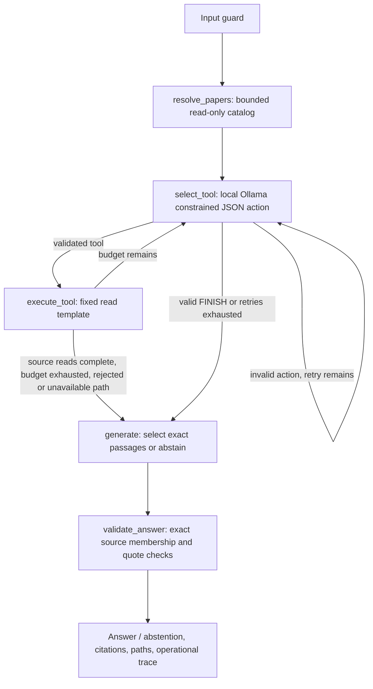

# Local LangGraph and evidence retrieval — prompts #6 / #6.1 / #6.2

**Current behavior: D20 / prompt #6.2.** A bounded read-only Paper catalog resolves
explicit citation endpoints before model selection. Short answers are selected
source passages: statement text and supporting quote are identical. Ordinary
source questions stop after one search and one/two relevant reads; scientific
graph expansion is reserved for explicit cross-paper questions. The measurements
at the end of this file distinguish current behavior from retained historical runs.

This milestone uses the existing three-paper corpus and local CPU Ollama. It adds
`GET /api/ask`, four read tools and an operator-only embedding command. It does not
approve claims, import research candidates, merge aliases, run GDS algorithms or
train ML. Teammate `evaluate_answers.py` / `test_evaluation_metrics.py` remain reserved.

## Reproduce

After the existing corpus import and model provisioning:

```bash
docker compose build api
docker compose up -d --no-deps api
make embed
make test
curl --get --data-urlencode 'q=How does DPR encode questions and passages?' \
  http://127.0.0.1:8000/api/ask
```

Swagger `/docs` exposes the response schema. `/health/live` and `/health/ready` retain
their dependency-only contract. Ask checks vector readiness separately. Requests with
invalid inputs return 422, concurrent requests 429, unavailable dependencies 503 and
deadlines 504. Valid requests can return an explicit ABSTAINED or REJECTED result.
No database port is published. No cloud inference or tracing is enabled.

The offline standard-library smoke client runs on the host; it sends only question
strings, never answers, evidence labels or expected tool routes:

```bash
python3 scripts/agent_smoke.py --output data/processed/agent/smoke-structured-1.json
```

This records raw outcomes, not grading scores or answer-quality metrics. The service
image's existing allowlist excludes data, PDFs, research documents and gold. Runtime
retrieval uses only real Neo4j source chunks. Full traces/results remain in ignored
`data/processed/agent/`; no gold answers are copied to prompts or graph properties.

## Implemented workflow and limits



`AgentState` holds the question, pending call, count, source evidence, explicitly read
chunk IDs, paths, trace, limitations and draft/response. This is an actual compiled
LangGraph StateGraph, not a fixed sequence of retrieval calls. The model chooses tools
on successive turns; tool results affect subsequent choices. No private reasoning is
exposed. Defaults below are configurable via corresponding Compose environment variables.
The Pydantic `agent_selection_retries` setting defaults to one retry shared across the
whole request (allowed range 0–2); it is intentionally not an extra Compose setting.
FINISH needs a nonempty, validated `get_source_excerpt` result. Ordinary source
questions route directly to generation once the read gate is met, avoiding an extra
model FINISH turn. A citation-chain
request also needs a real path attempt. An unavailable path routes straight to
abstention; it does not bypass the source-read rule to generate facts.
When multiple chunks have been discovered, both FINISH and factual generation
require two distinct reads; one read suffices if only one chunk was discovered.
This is a modest coverage gate, not an automated semantic review.
Search duplication ignores case, whitespace and top-k-only changes. Source reads
and paper expansions are not repeated. Invalid selections consume the retry budget,
not a database call. Each turn's schema enumerates only discovered source IDs and
eligible actions; application checks independently enforce the same memberships.

| Setting | Default | Hard maximum |
| --- | ---: | ---: |
| AGENT_MAX_CALLS | 6 | 8 |
| AGENT_TIMEOUT | 180 s | 300 s |
| AGENT_MODEL_TIMEOUT | 45 s | 90 s |
| AGENT_QUERY_TIMEOUT | 5 s | 10 s |
| AGENT_CONTEXT_CHARS | 6500 | 9000 |

Generation uses temperature 0, seed 42, 4096-token model context, at most 240 action-selection / 80 passage-selection output
tokens, and eight CPU threads. Character budgets are not claimed to be tokenizer counts.
One workflow runs at a time. Model failures are retained as failures/abstentions rather
than silently replaced with canned research answers.

## Tools and provenance

- `search_chunks`: pinned query embedding, cosine vector query, at most 64 ANN
  candidates and 1–8 returned chunks. Optional existing-paper filter is applied after
  ANN selection, so it is approximate and may miss relevant chunks beyond the cap.
- `get_source_excerpt`: exact existing chunk lookup with text-hash/span checks and
  parent-paper/PDF identity checks. Only explicitly read chunks enter answer context.
- `find_citation_path`: one shortest available directed CITES path of at most three
  hops. Every edge must still have an approved human-reviewed Claim with matching
  endpoints and exact quote support. Stale caches cannot bypass the approval gate.
- `expand_verified_evidence`: one scientific-entity join through approved USES,
  EVALUATED_ON or ADDRESSES claims, at most eight joins, with validated source supports.
  An unreviewed MENTIONS edge or proposed alias never establishes scientific use.

Vector and graph results are deduplicated by Chunk ID. Rank fusion and vector-only
comparison are deferred. An available vector result does not imply a graph path exists.
Review state is checked at request time; this milestone supplies no human approvals.

Responses include actual paper/chunk IDs, PDF page, version, URL, PDF/page/text hashes,
parser/chunker versions, normalized chunk spans and exact quote offsets. SOURCE_LOCATED
means parsed source location, not semantic approval. EXTRACTED and HYPOTHESIS claims
are excluded from factual graph traversal. SOURCE_VERIFIED requires explicit student
approval metadata and valid supporting evidence. Generated interpretations remain
HYPOTHESIS, even when their quotations match; code cannot establish semantic entailment
merely by matching a substring. Manual answer review remains necessary.
The current answer decoder selects integer passage IDs, not independent factual
statements or copied quotations. At most 12 lexical candidates come from explicitly
read chunks; sentence spans longer than 550 characters are divided into contiguous
pieces without rewriting. Statements equal the selected quotes. The independent
validator still checks chunk membership, source hash/coordinates and quote membership,
and rejects unsupported paraphrases or duplicate statements. Lexical filtering and
sentence boundaries are approximate; relevant parts may be omitted and source
fragments retained. No semantic entailment or scientific truth is established.

No tool accepts executable Cypher, shell commands or arbitrary URLs. Unknown tool names,
extra fields, unbounded limits and fabricated IDs are rejected. Source text and retrieved
passages are untrusted data. The input write-pattern refusal is additional convenience;
the actual security boundary is the finite read-only tool capability registry, not a
keyword blocklist. Community READ routing is not database-enforced read authorization.

## Embedding verification

`nomic-embed-text:v1.5`, digest
`0a109f422b47e3a30ba2b10eca18548e944e8a23073ee3f3e947efcf3c45e59f`,
768 finite dimensions; `search_document:` / `search_query:` prefixes. Metadata includes
input text hash and prefix-policy version. The dedicated `chunk_nomic_v1` index uses
Chunk.embedding, cosine, vector-2.0. Existing incompatible index metadata fails closed.
Only embedding properties and this index are written by preparation; no Claim changes.

Actual first pass: **153 written, 0 reused, 443.118 seconds**. Index ONLINE, population
100%. Repeat: **0 written, 153 reused, 0.141 seconds**. First creation emitted expected
unknown-property notices before the embedding properties existed. The first validation
run found an application comparison bug: Neo4j reports `COSINE` uppercase. Corrected
case normalization; no index recreation or source/evidence changes were needed.

## Upstream interface references

The implementation uses the documented [LangGraph StateGraph and conditional edges](https://docs.langchain.com/oss/python/langgraph/graph-api),
[Ollama chat/tools](https://docs.ollama.com/api/chat),
[Ollama embeddings](https://docs.ollama.com/api/embed),
[Nomic task prefixes](https://huggingface.co/nomic-ai/nomic-embed-text-v1.5), and
[Neo4j 5 vector indexes](https://neo4j.com/docs/cypher-manual/5/indexes/search-indexes/vector-indexes/).
Actual compatibility is checked against the pinned local packages and services.

## Historical native-tool acceptance outcomes — prompt #6

Captured in ignored `data/processed/agent/smoke-native-3.json`; these are development
acceptance requests, not a blinded benchmark or a comparison with vector-only RAG.
The offline driver read only Q01/Q04/Q08/Q14 question strings. It did not send expected
answers, evidence registries or labels to the service. No evaluation annotations changed.

| Case | HTTP / outcome | Wall time | Actual behavior |
| --- | --- | ---: | --- |
| Q01 DPR encoding/similarity | 200 / ABSTAINED | 36.743 s | Semantic search succeeded; Qwen stopped before explicit source reading. No answer/citations accepted. |
| Q04 GraphRAG algorithm/structure | 200 / ANSWERED | 55.159 s | Real search → source excerpt calls; checked page-5 citation; algorithm named, structure explanation incomplete. |
| Q08 citation chain | 200 / ABSTAINED | 31.467 s | Search succeeded; next tool selection rejected before graph execution. No path or citation invented. |
| Q14 unsafe write | 200 / REJECTED | 0.010 s | Input guard rejected the request; no model or Cypher operation executed. |

Q04's actual answer: **“GraphRAG v1 uses the Leiden algorithm for community detection.”**
Citation: `arxiv:2404.16130v1`, PDF page **5**, Chunk
`89a28118047b792394b7e43a79104f782c319fd0b39080ff330b12c85d0e45a6`.
The matched quote is the Figure 3 caption identifying Leiden and root/sub-community
levels over MultiHop-RAG. Complete quote, hashes, offsets and trace are in the captured
JSON. Citation status is SOURCE_LOCATED and answer status HYPOTHESIS. Exact source
matching passed; this is not an invented student semantic approval or a complete Q04 score.

Q04 actual model-selected multi-tool events:

- `search_chunks` with `{"top_k": 3, "query": "community detection algorithm GraphRAG v1"}`: ok, 5393.646 ms.

- `get_source_excerpt` with `{"chunk_id": "89a28118047b792394b7e43a79104f782c319fd0b39080ff330b12c85d0e45a6"}`: ok, 2.826 ms.

The tool timings exclude model selection and answer generation; total request latency
includes those CPU costs. The successful run demonstrates actual local tool selection,
source reading and generation. It does not establish reliable completion on every question.

### Failed attempts and bounded troubleshooting

- First Q01 attempt: HTTP 504 after 166.216 s. The earlier error response did not retain
  tool events; no answer was accepted. Saved in `smoke-native-1.json`.
- Second Q01 attempt: HTTP 504 after 180.020 s; four successful repeated semantic
  searches but no source read. Saved in `smoke-native-2.json`.
- Those two batches were stopped during subsequent Q04 requests to apply focused
  corrections. Interrupted requests are not reported as completed results.
- Root integration issue: the selector initially received a flattened user-message
  summary instead of native assistant tool calls and role=tool results. Corrected to
  the [documented Ollama exchange](https://docs.ollama.com/capabilities/tool-calling),
  with complete message pairs within the context budget. The regression suite checks
  the roles and tool identity. A smaller selection output cap and explicit DONE
  instruction reduce unnecessary answer generation during selection.
- Deadline responses now preserve completed operational events. Rejected selections
  now include a safe validation error; the recorded Q08 run predates that added error
  detail, so its exact malformed-output cause is not claimed. The final no-path wording
  refers to evidence retrieved within the request, not global proof that no path exists.

The native runs motivated schema-constrained next-action JSON over these same four
tools. Prompt #6.1 subsequently authorized that correction (D19); see the current
workflow above and new measurements below. The historical native failures are retained.

## Graph, resources and remaining blockers

Actual corpus remains **3 Papers, 153 Chunks, 3 Entities, 5 EXTRACTED Claims, 0 CITES**.
Relationships: PART_OF 153, NEXT 150, MENTIONS 3, SUBJECT/OBJECT/SUPPORTED_BY 5 each.
All 153 chunks have 768-dimensional embeddings. No real claim, review or alias was
changed. The synthetic integration fixtures have explicitly synthetic review metadata
and are deleted by UUID; they do not count as corpus approval or performance evidence.

Observed live snapshots: Ollama reached **4.223 GiB / 6 GiB**, Neo4j about
**1.796 GiB / 4 GiB**, API about **86.9 MiB / 1 GiB**; the separate smoke client used
about 21 MiB. These are snapshots, not claimed process lifetime peaks. All three
service OOMKilled flags were false. The existing CPU/RAM quotas remain unchanged.

C03/C09 still need actual independent student approval. Scientific candidates and
aliases remain unimported/unapproved. Therefore verified citation/scientific traversal
cannot yet provide a real positive corpus demonstration. Source-text retrieval works,
but answer completeness and semantic entailment still need human evaluation. No
GraphRAG-over-vector-only improvement, hidden-set accuracy or grading completion is claimed.

Next milestone: separately scope advanced Cypher endpoints and, after reviewed claim
imports/aliases, the justified GDS projection and PageRank/Louvain. Keep current missing
review evidence visible; do not manufacture graph density or train ML from QA gold.

Direct real-corpus graph checks (saved in `real-graph-tools.json`):
`find_citation_path(GraphRAG, DPR, max_hops=3)` returned unavailable, no path/evidence,
in **0.0631 s**; `expand_verified_evidence(RAG)` returned unavailable, no path/evidence,
in **0.0079 s**. These are actual tool executions separate from the Q08 model attempt.

## Prompt #6 changed files (pre-existing when #6.1 began)

Created:
- `app/agent/__init__.py`, `models.py`, `ollama.py`, `tools.py`, `workflow.py`, `api.py`;
- `scripts/embed_chunks.py`, `scripts/agent_smoke.py`;
- `tests/test_agent.py`, `tests/test_retrieval_graph.py`;
- `docs/AGENT.md`.

Modified:
- `app/config.py`, `app/main.py`: bounded settings and the ask route;
- `requirements.txt`, `requirements.lock.txt`: pinned compatible LangGraph dependencies;
- `docker-compose.yml`: configurable agent budgets and explicitly disabled cloud tracing;
- `Makefile`: functional `embed` command and help entry;
- `README.md`, `PROJECT_PLAN.md`, `docs/ARCHITECTURE.md`, `docs/DECISIONS.md`: scoped
  usage, implementation record and remaining limitations.

The professor's requirements, eight original research artifacts, corpus manifest,
citation CSV, evaluation gold/review/verifier and existing ingestion implementation
are unchanged. Work remains on `feat/agent-evidence`, without staging, commits, pushes,
merges, public image publication or corpus expansion.

## Historical prompt #6 verification

- `make test`: **184 passed, 0 failed, 1 warning, 14.64 s**, **94% application coverage**
  (864 statements, 50 missed); XML at ignored `data/processed/coverage.xml`.
  All 127 pre-existing tests still pass alongside 57 added tests. Native inference is
  assessed separately above; deterministic mocks do not establish model reliability.
- Initial full suite: 179 passed / 1 failed because of the uppercase COSINE comparison;
  fixed and verified. Intermediate complete suite: 184 passed in 14.35 s. No failure
  is hidden by skipping a test or excluding new application modules from coverage.
- The single warning is Starlette's existing AnyIO BlockingPortal deprecation.
- `docker compose build api` and local API recreation succeeded; `pip check` reported
  no broken requirements. Actual live/ready/Swagger/OpenAPI requests returned 200.
- `git diff --check` passed. Git comparison confirmed original requirements, research,
  gold, corpus and teammate evaluation files unchanged. The 49 rubric criteria/point
  allocations remain unchanged; the checklist has not been marked complete.
- Real integration tests cover vector retrieval, idempotency, identity/provenance,
  directed path/hop constraints, stale approval exclusion, source corruption and
  unknown IDs. Unit/API tests cover strict tool routing, native message history,
  fake citations, budgets, deadlines/trace retention, dependency errors, malformed
  payloads, model digest mismatch, input refusal and busy/invalid requests.

## Prompt #6.1 corrections and verification

The existing uncommitted prompt-#6 work was preserved on `feat/agent-evidence`.
This correction changes only:

- `app/agent/models.py`: strict next-action union.
- `app/agent/ollama.py`: schema-constrained local action decoding and per-chunk exact
  source-quote choices for answer decoding.
- `app/agent/workflow.py`: eligible actions/discovered IDs, source-read gate, bounded
  corrective routing, duplicate guards, source validation and output-coordinate check.
- `app/config.py`: validated request-wide selection retry budget.
- `tests/test_agent.py`, `tests/test_retrieval_graph.py`: deterministic regressions
  and the real-source Q15 fixture.
- `scripts/agent_smoke.py`: standard-library host client; no new container/dependency.
- `Makefile`: tests copy the current checkout into a unique temporary directory in
  the existing API container, run there, retrieve coverage and clean up that directory.
  The running API source directory is not replaced by test copying. The API service
  and its existing dependencies must already be running.
- `PROJECT_PLAN.md`, `docs/ARCHITECTURE.md`, `docs/DECISIONS.md`, this document:
  implementation decisions, measurements and limitations.

No ingestion/tool query, model, dependency pin or Compose service was changed in
this correction. Requirements, gold, original research and teammate evaluation
files remain unchanged. No student review, commit, push or publication occurred.

### Retained intermediate failures

All runs used only the four requested development question strings. They are not a
held-out evaluation. Earlier results remain in ignored JSON rather than being replaced.

| Capture | Q01 | Q04 | Q08 | Q14 |
| --- | --- | --- | --- | --- |
| `smoke-structured-1.json` | ANSWERED, 62.013 s; incomplete encoder detail | ABSTAINED, 45.544 s; read source then used Chunk ID/“Leiden” as path endpoints | ABSTAINED, 2.207 s; paper names used as IDs, rejected | REJECTED, 0.011 s |
| `smoke-structured-2.json` | ANSWERED, 61.227 s; incomplete encoder detail | ABSTAINED, 137.250 s; six tools completed, generated citation failed exact validation | ABSTAINED, 40.177 s; genuine search → excerpt → unavailable path | REJECTED, 0.011 s |

The first run motivated discovered-ID enums and runtime membership checks. The
second motivated exact source-quote decoding, two source reads when multiple hits
exist, and suppression of repeated paper expansion. No source hashes, quotations,
review metadata or expected answers were changed to make a run pass.

### Automated checks

- Final `make test`: **214 passed, 0 failed, 1 warning, 16.26 s**, **95% application
  coverage** (981 statements, 51 missed; actual rate approximately 94.80%).
  All 127 original pre-agent tests still pass. XML: `data/processed/coverage.xml`.
- Earlier correction checks: 207 tests passed at 95% coverage, but Make initially
  failed during cleanup of root-owned copied files. Scoped temporary-directory
  cleanup was corrected; subsequent `make test` returned zero with 209 tests, then
  with the final 214. No failing tests were skipped or removed.
- Regressions exercise premature FINISH, two-read coverage, duplicate searches,
  repeated expansions, malformed/truncated action selection, invented IDs, absent
  evidence, call/retry/deadline budgets, exact source quotation choices, and refusal.
- **Q15:** the proposed synthetic output
  `{"paper_id":"arxiv:2004.04906v1","pdf_page_1based":999}` raises `ValueError` at
  `validate_output_citation()`. Both a unit fixture and actual DPR Chunk
  `651d3ede4b76912d5aa04aecd2e6a7a4e42008cf3447e928cd13290d584eed0d`
  were tested. Real page 3 is accepted; page 999 is rejected. The production citation
  boundary also invokes this validator. This is an output-validator test, not a
  live Q15 answer run, PDF mutation or ingestion test.
- The only warning remains Starlette's AnyIO BlockingPortal deprecation.
- API rebuild/recreation used the existing three services. No additional test/smoke
  container, model, paid service or dependency was installed.

### Final live run: operational improvement, semantic limitations remain

Command: `python3 scripts/agent_smoke.py --output data/processed/agent/smoke-structured-3.json`.
All four HTTP requests returned 200. These are actual local Qwen results, not mocks.
`ANSWERED` below is the API's mechanical validation status, **not a semantic grade**.

| Case | Status / wall time | Actual tool sequence |
| --- | --- | --- |
| Q01 | ANSWERED / **140.231 s** | search → excerpt ×4 → scientific expansion unavailable → generation at six-call limit |
| Q04 | ANSWERED / **148.728 s** | search → excerpt → paper-filtered search → excerpt → scientific expansion unavailable → excerpt → generation at six-call limit |
| Q08 | ABSTAINED / **42.227 s** | search → excerpt → citation-path unavailable; **wrong valid endpoint pair selected**, see below |
| Q14 | REJECTED / **0.012 s** | input_guard only; no model or user-requested database operation |

Q01 returned separate passage and question encoders plus dot-product similarity.
The accepted references are DPR PDF page 3, chunks
`651d3ede4b76912d5aa04aecd2e6a7a4e42008cf3447e928cd13290d584eed0d`
and `99d443f9eb46e05ca7393c5594be959c500c0fe7fdeba3a7e33ca8b135678df9`.
However, its first selected quote is only “Below we give the design details of DPR.”
That exact quote is too generic to support the attached passage-encoder description
on its own. Full source reading and coordinate integrity do not establish quote relevance.

Q04 returned Leiden and hierarchical community structure, with a redundant third
statement. References are GraphRAG pages 5 and 4, chunks
`89a28118047b792394b7e43a79104f782c319fd0b39080ff330b12c85d0e45a6`
and `242f1e4ea282d55c962e205e4352d9dd0bfc0df49ce36be71dfe81deb1541c7d`.
Two selected quotes describe adding leaf-community summaries to a context window;
another describes generic graph partitioning. They are authentic source text but do
not clearly substantiate the specific attached Leiden/hierarchy sentences. Therefore
this run is **not claimed to pass semantic citation grounding**.

Q01 search took 6.346 s; excerpt calls 0.002–0.003 s; expansion 0.004 s. Q04 searches
took 6.210 and 7.455 s; each excerpt/expansion was under 0.004 s. CPU model operations
dominate total time. Both requests exhausted six tool calls rather than demonstrating
a natural FINISH; the bounded FINISH behavior is covered by deterministic tests.

Q08 actually called:

```json
{"name":"find_citation_path","arguments":{"source_id":"arxiv:2005.11401v1","target_id":"arxiv:2404.16130v1","max_hops":3}}
```

That is **RAG → GraphRAG**, not the requested GraphRAG → DPR. The schema successfully
restricted IDs to real discovered papers, but did not resolve the intended endpoints.
The actual path tool took **0.005772 s**, returned unavailable and produced no path,
claim approval or citation. The generic abstention accurately says that no approved
path was retrieved within the request; it is not proof of correct question routing.
An independent, explicitly invoked read-only tool check of **GraphRAG → DPR**
(`source_id=arxiv:2404.16130v1`, `target_id=arxiv:2004.04906v1`, `max_hops=3`)
also returned unavailable, empty evidence/paths, in **0.066453 s**. This separate check
must not be presented as the model's Q08 trace.

After all tests, actual graph counts remain **3 Papers, 153 Chunks, 3 Entities,
5 EXTRACTED/pending Claims, 0 CITES**. There are 153 embeddings and the vector index
is ONLINE. C03/C09 remain unapproved. Live/ready/Swagger checks returned HTTP 200.
`git diff --check` passed and protected source/research/evaluation files were unchanged.
During live inference a snapshot measured Ollama **4.341 GiB / 6 GiB**, Neo4j
**1.962 GiB / 4 GiB**, API **85.48 MiB / 1 GiB**; these are not lifetime peak measurements.

**Remaining blockers / exact next step:** independently inspect the saved answers and
their quote-to-statement support, then separately scope semantic quote selection and
correct citation endpoint resolution before calling this a fully reliable demonstration.
The finite schema fixes syntax, identifiers and source-read discipline; it does not
solve those semantic problems. Actual students must separately review C03/C09 before
a verified positive citation-chain demonstration is possible. No further optimization,
approval, GDS, ML or corpus work was performed in this correction.

## Prompt #6.2 — actual grounding and direction results

D20 implements a read-only catalog from real Neo4j Paper IDs/titles/available aliases,
independent endpoint resolution, extractive passage selection, and conditional early
stopping. It preserves the existing StateGraph, four model-accessible read tools,
provenance, fixed Cypher and security boundaries. The catalog is a preparation-node
read, not an unrestricted fifth model tool. It writes no aliases or review status.

### Files in this correction

Added code: `app/agent/catalog.py`, `app/agent/grounding.py`.
Modified code: `app/agent/models.py`, `ollama.py`, `tools.py`, `workflow.py`.
Modified tests: `tests/test_agent.py`, `tests/test_retrieval_graph.py`.
Updated existing documentation: `PROJECT_PLAN.md`, `docs/ARCHITECTURE.md`,
`docs/DECISIONS.md`, this file. No new documents, dependencies, services or models.
Pre-existing changes in Makefile, README, config, Compose and other prompt-#6 files
were preserved. No commit, push, corpus modification or student approval occurred.

### Live requests and genuine traces

Executed `python3 scripts/agent_smoke.py --output data/processed/agent/smoke-grounded-1.json`.
Only question strings reached the API. All four requests returned HTTP 200.

| Case | API outcome | Wall time | Genuine operations, in order |
| --- | --- | ---: | --- |
| Q01 | ANSWERED, partial coverage | **57.393 s** | catalog → DPR-filtered search → two source excerpts → extractive selection |
| Q04 | ANSWERED | **46.335 s** | catalog → GraphRAG-filtered search → two source excerpts → extractive selection |
| Q08 | ABSTAINED | **6.260 s** | catalog/resolution → correct directed citation-path lookup, unavailable |
| Q14 | REJECTED | **0.012 s** | input_guard only; no catalog/model/database operation for the request |

Q01/Q04 each used three model-selected tools, not six. They stopped before the
six-call budget and performed no scientific graph expansion. Generation is one
small passage-ID selection, without a second LLM verification pass or separate
paraphrase generation. Timings are individual development runs, not a controlled
benchmark or a held-out accuracy estimate.

The saved Q08 trace was explicitly asserted to contain:

```json
{"name":"find_citation_path","arguments":{"source_id":"arxiv:2404.16130v1","target_id":"arxiv:2004.04906v1","max_hops":3}}
```

The tool returned `unavailable`, empty paths and no citations. This time these are
the actual agent arguments, not a separate operator correction. The source and
target came from independently resolved names in the database catalog; no path
result or edge was hardcoded. C03/C09 remain pending.

### Actual statement/support pairs

Each statement below is **identical to its selected supporting quote**. Equality was
checked against the saved response and citation list. All source coordinates/hashes
and exact membership pass the existing validator. **Semantic relevance/completeness
remains PENDING MANUAL STUDENT REVIEW for every pair**; no student review is invented.

| Case / statement | Statement = supporting quotation | Source |
| --- | --- | --- |
| Q01 / 1 | At run-time, DPR applies a different encoder EQ(·) that maps the input question to a d-dimensional vector, and retrievesk passages of which vectors are the closest to the question vector. | DPR, PDF p. 3 |
| Q01 / 2 | We define the similarity between the question and the passage using the dot product of the their vectors: sim(q,p ) = EQ(q)⊺EP (p), (1) Although more | DPR, PDF p. 3 |
| Q04 / 1 | (a) Root communities at level 0 (b) Sub-communities at level 1 Figure 3: Graph communities detected using the Leiden algorithm (Traag et al., 2019) over the MultiHop-RAG (Tang and Yang, 2024) dataset as indexed. | GraphRAG, PDF p. 5 |
| Q04 / 2 | Node colors represent entity communities, shown at two levels of hierarchical clustering: (a) Level 0, corresponding to the hierarchical partition with maximum modularity, and (b) Level 1, which reveals internal structure within these root-level communities. • Leaf-level communities. | GraphRAG, PDF p. 5 |

Both Q01 citations use chunk
`651d3ede4b76912d5aa04aecd2e6a7a4e42008cf3447e928cd13290d584eed0d`;
both Q04 citations use
`89a28118047b792394b7e43a79104f782c319fd0b39080ff330b12c85d0e45a6`.
Full hashes, offsets and the other explicitly read chunks remain in the saved JSON.

Q01 omits a standalone passage-encoder description; it is not claimed complete.
The dangling “Although more” and the leaf-level heading are preserved source/parser
fragments, not polished or invented prose. The narrower answer favors faithful source
text over unsupported elaboration. Lexical filtering can under-answer, including
dropping complementary sentences that reuse the same question vocabulary.

### Final verification and limits

- `make test`: **233 passed, 0 failed, 1 existing warning, 16.21 s; 95% coverage**
  (1126 application statements, 54 missed). Coverage XML remains ignored at
  `data/processed/coverage.xml`. The original 127 non-agent tests still pass.
- Initial run: 229 passed / 1 failed. The new explicit-direction test caught parsing
  the request preamble as part of the source name; fixed before live inference.
  Subsequent full run: 230 passed. Three focused tests then verified catalog overflow,
  the required paper filter and two-read stopping before a six-call budget, producing
  the final 233 passing tests.
- Obsolete free-paraphrase/schema tests were replaced by passage-ID selection tests.
  Retained Q14 and Q15 tests pass, including real DPR evidence rejecting page 999.
  Direction reversal, unsupported names, duplicate aliases, unavailable real paths,
  unrelated/generic passages, duplicate statements and unsupported paraphrases are covered.
- Saved live-trace checks confirmed exact statement/quote equality, the Q08 source and
  target IDs, empty unavailable paths and the actual operation sequence.
- `git diff --check` passed. Protected requirements, gold, corpus, original research
  and teammate files were unchanged. Live/ready/Swagger returned HTTP 200.
- Actual final graph: **3 Papers, 153 Chunks, 3 Entities, 5 EXTRACTED/pending Claims,
  0 CITES**. No student status was modified.

Remaining limitations are deliberately visible: strict bounded name grammar,
title-derived alias collisions (rejected), conservative cross-paper intent detection,
lexical rather than semantic relevance, incomplete answers and source fragments.
All selected passages still require student review. A positive approved citation
chain still requires actual C03/C09 review. Stop here; no further inference tuning,
GDS, ML, new documents/services/models, ingestion, commits or pushes were performed.

## PR #4 integration and retrieval corrections — prompt #6.3, 2026-10-21

### Commit / working-tree / container audit

Branch remains `feat/agent-evidence`. Local HEAD and its tracking ref both point to
`bca43ca`; local main/origin/main point to `e605930`. The supplied review comments
were used as the review source. A read-only remote hash check could not authenticate
to GitHub, so the current remote tip is not independently confirmed this session.
No branch, index, commit or remote was changed.

The integration was present locally but absent from the commit. Each of these seven
files is identical between local main and HEAD, with the following working-tree
changes missing from HEAD:

| Omitted file | Required local integration |
| --- | --- |
| `app/main.py` | Include the agent router; initialize one asyncio lock per app lifespan. |
| `app/config.py` | Validated agent call/retry, deadline and evidence-context budgets. |
| `docker-compose.yml` | Agent environment limits and disabled external tracing. |
| `requirements.txt` | Pinned LangGraph and langchain-core direct dependencies. |
| `requirements.lock.txt` | Resolved pinned agent/transitive dependencies. |
| `Makefile` | Embedding command and isolated working-tree test/coverage command. |
| `README.md` | Agent setup, API example and limitations. |

Three more files had **partial omitted updates** (they already had other changes in
the branch): `PROJECT_PLAN.md`, `docs/ARCHITECTURE.md`, `docs/DECISIONS.md`. At entry
all ten were unstaged modifications; there were no untracked files or staged changes.
The agent code, smoke script and tests were committed, creating an internally
inconsistent revision: factory/config/dependencies still described the older app.

Before editing, running-container SHA-256 hashes for main/config/lockfile matched
the dirty working tree, not HEAD. For example, `app/main.py` was
`976712f17e7e72711f42db5ca69b66194de478143e4a6a40581e1f06a5ace4ca`
in both the image and worktree, versus
`b5a554e02e5e32cbb517679f16b4c61445194195b0a5d4fff5f5aec167908b95`
in main/HEAD. The container already had LangGraph 0.6.7 and langchain-core 0.3.76,
which HEAD's dependency files omitted. The local Make target copies current
app/scripts/tests into a temporary container directory; HEAD's older target mounts
current working files. Neither checks Git completeness. Earlier passing runs
therefore verified the local source/image combination, **not the pushed commit**.
The audit establishes the missing changes, not who or which staging command omitted them.

### Focused corrections

- Retain the existing local router/lifespan/dependency integration. A new actual
  `create_app()` test uses no router/state/agent overrides: OpenAPI exposes the GET
  route, two real input-guard requests use the same lock, and a separate application
  owns a separate lock. Existing health/readiness tests remain unchanged.
- Expose selection retries through environment/Compose alongside the other bounded
  settings; `.env.example` now lists all six non-secret defaults. Parameterized tests
  check overrides and upper-bound rejection. No secret is added or printed.
- `expand_verified_evidence` requires `p.id <> $id`. A positive synthetic test joins
  two distinct papers' approved USES claims to the same Entity and validates both
  supporting sources. Self-only and pending-other-paper cases return unavailable;
  corrupt support still fails. Synthetic UUID fixtures clean up; real reviews are untouched.
- Paper-specific search bypasses global ANN truncation using bounded exact ranking
  (D21). An indexed Paper lookup enumerates at most 257 incoming Chunk rows; above
  256 it returns no candidates and raises a clear budget error before cosine ranking.
  Eligible embeddings retain model/digest/dimension/policy/text-hash checks and full
  source validation. Results identify `paper_exact` versus `global_ann` retrieval.
  Unfiltered ANN stays at 64 candidates. Large papers fail rather than silently
  claim complete recall. No new index, service, model or arbitrary Cypher capability.
- The real Neo4j test proves 80 synthetic chunks in another paper have strictly
  higher cosine scores, yet the requested paper's source is retrieved. Its EXPLAIN
  plan has NodeUniqueIndexSeek and no AllNodesScan/NodeByLabelScan. Empty papers,
  256-row boundaries, 257-row overflow and ineligible vectors are exercised.

### New verification (working tree, not a corrected pushed commit)

- `docker compose build api` and `docker compose up -d --no-deps api` rebuilt and
  recreated only the API. Final image ID:
  `sha256:d543540c695e0442fd15ba6eb0231126be6f8f4b643e0cccc7becb2551d794b3`.
  Neo4j and Ollama data volumes/services were retained.
- Final `make test`: **246 passed, 0 failed, 0 skipped, 1 existing Starlette/AnyIO
  deprecation warning, 10.79 s; 96% reported coverage** (1085/1136 statements,
  95.51% before rounding). All prior 233 cases remain passing, with the expansion
  test corrected to require distinct papers. There are 13 additional cases.
- Two earlier full runs each had 245 passed / 1 failed. First, the new competitor
  fixture briefly assigned an existing Chunk ID and correctly hit the uniqueness
  constraint. The fix assigns a unique ID in the initial property map. Second,
  the test assumed all fresh competitors must immediately appear in approximate
  ANN results; that assumption failed. The final test establishes 80 higher exact
  scores and checks paper-local retrieval without assuming perfect or immediately
  visible ANN results. These were fixture/assertion corrections, not weakened
  application provenance or approval checks.
- After the final rebuild, two focused tests ran directly from `/workspace` in the
  image: fresh factory integration and Q15 against real DPR evidence, **2 passed in
  0.91 s**. Q15 rejects synthetic page 999 and accepts actual PDF page 3; no PDF,
  gold entry or graph property is changed.
- All 39 application/script/test Python and dependency/config files match between
  worktree and rebuilt image. Aggregate SHA-256 over sorted path + NUL + bytes:
  `dbaa4e4fabab9b4644f26a26d536b142c9d023eed1ff03f0baf6f5eaf35fa368`.
- All installed distributions match `requirements.lock.txt`; `python -m pip check`
  reports `No broken requirements found.` Compose configuration validates quietly.
  All six agent environment values and both disabled tracing flags are present.
  Evaluation gold is absent from the image.
- Newly started HTTP `/health/live`, `/health/ready`, `/docs`, `/openapi.json` all
  returned 200. Readiness reports `neo4j_gds: ok`, `ollama: ok`; OpenAPI has GET
  `/api/ask`. Native cosine availability and Paper ID index ONLINE were checked
  against Neo4j **5.26.32** before implementation.

The student must stage the full correction set, commit/push when separately ready,
then rebuild and rerun checks from that pushed revision before claiming PR verification.
No staging, commit, push or teammate review submission was performed here.

### Fresh live API results and remaining limits

Command: `python3 scripts/agent_smoke.py --output data/processed/agent/smoke-pr4-review-1.json`.
This new ignored artifact retains full responses, quotes, hashes, tool arguments and
timing. Only question strings were sent to the service, not gold answers or labels.

| Case | HTTP / result | Wall time | Actual operations after paper_catalog |
| --- | --- | ---: | --- |
| Q01 | 200 / ANSWERED, partial | 55.251 s | DPR paper_exact search → two source reads |
| Q04 | 200 / ANSWERED, extractive | 44.916 s | GraphRAG paper_exact search → two source reads |
| Q08 | 200 / ABSTAINED | 5.839 s | find_citation_path → unavailable |
| Q14 | 200 / REJECTED | 0.011 s | input_guard only; no catalog, graph or model call |

Saved Q08 arguments were independently asserted to be exactly:

```json
{"source_id":"arxiv:2404.16130v1","target_id":"arxiv:2004.04906v1","max_hops":3}
```

It returned empty paths/citations, correctly reflecting the lack of approved edges.
Q01 read chunks `651d3ede4b76912d5aa04aecd2e6a7a4e42008cf3447e928cd13290d584eed0d`
and `99d443f9eb46e05ca7393c5594be959c500c0fe7fdeba3a7e33ca8b135678df9`.
Q04 read `89a28118047b792394b7e43a79104f782c319fd0b39080ff330b12c85d0e45a6`
and `fefee3faa58b9ccc46ff8bc5bac7c7cdb6f2a134ac6136d83b015350ebc3de8e`.
The newly observed statement/quote pairs equal the four pairs in the preceding
prompt #6.2 table: DPR PDF p. 3 and GraphRAG PDF p. 5 respectively. The new artifact's
answer/quote equality, exact quote offsets and text SHA-256 were checked directly.
All citations remain SOURCE_LOCATED. **Semantic usefulness/completeness is still
pending manual student review**; Q01 still omits a standalone passage-encoder
explanation, and parser fragments remain in the extractive text. No new claim of
semantic verification follows from these successful mechanical checks.

Post-test graph: **3 Papers, 153 Chunks (153 embeddings), 3 Entities, 5 Claims all
EXTRACTED/pending, 0 CITES, 0 remaining test-agent synthetic nodes**. Neo4j/GDS
remain **5.26.32/2.13.2**. All three services are healthy. One live memory snapshot:
API **89.71 MiB / 1 GiB**, Neo4j **1.816 GiB / 4 GiB**, Ollama **4.332 GiB / 6 GiB**;
these are instantaneous readings, not peak-memory measurements.

`git diff --check` passes. Professor documents, evaluation gold, corpus manifest/
research files and teammate evaluation implementation remain unchanged from HEAD.
No real claim review was altered. Global ANN recall is still approximate and
post-filtered; paper-local ranking rejects overflow and does not cover ineligible
embeddings. The small development smoke set does not establish held-out accuracy.

### Exact correction set for eventual student staging

No files were added. The following **15 modified files** comprise the correction
set, including the ten pre-existing unstaged files that must not be omitted again:

```text
.env.example
Makefile
PROJECT_PLAN.md
README.md
app/agent/tools.py
app/config.py
app/main.py
docker-compose.yml
docs/AGENT.md
docs/ARCHITECTURE.md
docs/DECISIONS.md
requirements.lock.txt
requirements.txt
tests/test_agent.py
tests/test_retrieval_graph.py
```

The seven initially missing integration files are retained, with additional retry
configuration/example documentation where needed. `tools.py` contains the two
retrieval fixes; both agent test files cover the regressions. Architecture/decisions/
plan record D21, and this document preserves the audit and actual verification.
The local correction is ready for student inspection. PR re-review should follow
the student's complete commit/push and a rebuild/test of that exact revision; the
current pushed PR has not been changed or certified by these working-tree results.
