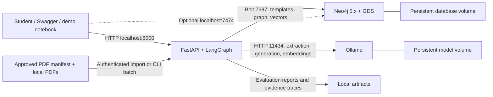
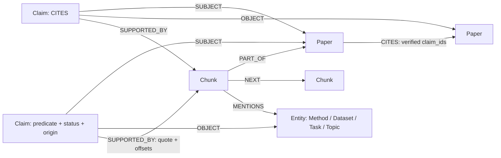
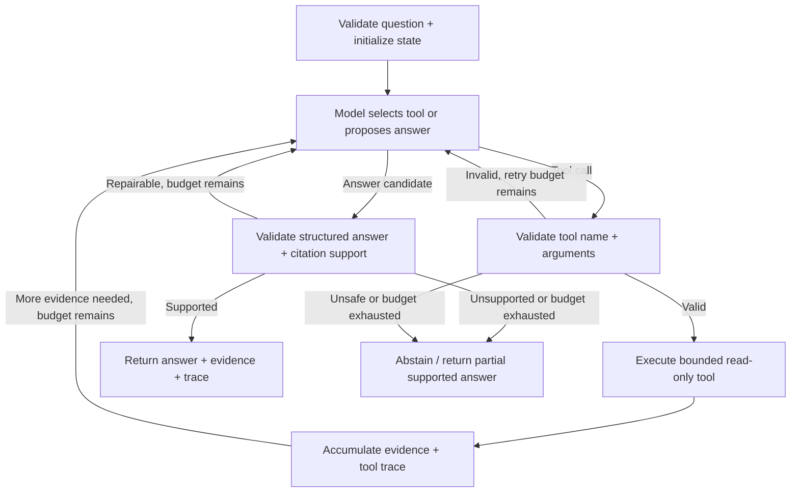

# Architecture — AI Research GraphRAG Assistant

**Status: infrastructure, ingestion, bounded retrieval/agent, advanced graph GET APIs and the three-paper GDS slice implemented; the fixed ML pilot, protected corpus API and local delivery tooling are now implemented; remote CI is verified through merged PR #12; API publication is authorized conditionally but remains incomplete.** The user authorized local infrastructure on 2026-10-19 and three-paper ingestion on 2026-10-20; see D13–D14 and D23 in [DECISIONS.md](DECISIONS.md). The [specification](requirements/projects_spec.md) and [checklist](requirements/project_checklist.md) govern scope. Dated implementation evidence supersedes historical proposals below.

### API distribution boundary (D26)

The manual GHCR workflow builds the existing API and a separate source-delivery wrapper
(`docker/api-release.Dockerfile`). It adds only public, hash-verified third-party
sources/notices; it does not alter Compose services, the evidence graph or ML workflow.
Package-write permissions exist only in the manually invoked release job. Current-main
revision checks, dependency/content scans and unresolved-license gates precede login.
The native source mappings and local gates pass; publication awaits release review
and the manual main workflow. See
[IMAGE_PUBLICATION.md](IMAGE_PUBLICATION.md). No Neo4j/GDS image is published.

### Final implementation update — 2026-11-02 (D24)

The protected persisted graph now has 3 Papers, 153 Chunks, 17 Entities and 25 Claims
(22 student-approved, three pending), with two CITES, 60 SUPPORTED_BY, 150 NEXT,
153 PART_OF, 25 SUBJECT, 25 OBJECT and 148 MENTIONS relationships. All 153 embeddings
remain present. The 145 new deterministic occurrence edges carry source/policy hashes
and `NOT_REVIEWED`; they do not alter Claims, canonical identities or student histories.
See [MENTIONS_ENRICHMENT.md](MENTIONS_ENRICHMENT.md).

`app/ml` extracts eight local graph features from the controlled canonical mention
layer and actual same-paper NEXT. The fixed 10-train/5-test supervised experiment ran
without changing Neo4j. Its zero logistic accuracy is retained alongside the majority
baseline; this is a failed exploratory generalization result, not a useful classifier
claim. The earlier eight-paper proposal is unmet. [GRAPH_ML.md](GRAPH_ML.md) records
all metrics, feature distributions, fixed settings, source/label gates and limitations.

The API adds `GET /api/corpus`, `POST /api/corpus/import` and
`GET /api/topics/{ident}/graph?depth=2`. Import is disabled without an environment
secret and allows only the pinned prototype, with zero or one optional extraction
sample per paper. HTTP cannot replay reviews; already-present papers return without
writes, partial/inconsistent state returns 409. The existing CLI preserves detailed
per-paper audit and partial-extraction behavior. One API import runs at a time;
this is a single-worker localhost deployment, not multi-tenant production scheduling.
A named `corpus_files` volume stores HTTP import files. It is separate from the
host-mounted operator corpus; no source PDFs or annotation data enter the image.

Concept exploration traverses actual Entity <- OBJECT - approved Claim - SUBJECT ->
Paper relationships to depth one/two, using complete source-support validation and
review snapshot checks. It is a bounded response, not unrestricted neighborhood Cypher.
The existing agent remains model-directed; after a successful citation path it must
explicitly read every supporting Chunk before returning exact bibliography quotes.
The graph path itself is always the real retrieved directed path, never model text.

Editable/viewable diagrams, a live executable notebook and final quality/CI evidence
are linked from README. GDS projection lifecycle and algorithms remain unchanged.
Historical status paragraphs below describe their original milestones; the dated
records and [FINAL_RUBRIC_AUDIT.md](FINAL_RUBRIC_AUDIT.md) determine current scope.

### Implemented advanced graph and GDS slice — prompt #7B

PR #7 supplies the reviewed-evidence code; the separately authorized #7A application
is present in the live database (22 approved Claims, three pending). This milestone
only reads that source graph. Five GET routes under `/api/papers` implement
`/{paper_id}/paths`, `/{paper_id}/shared`, `/{paper_id}/related`, `/centrality` and
`/communities`. Source path traversal reuses the agent tool; new exploration uses
fixed Cypher, approved/scoped identities and the existing complete support validator.
Shared/related responses preserve contributing Claim IDs, evidence and qualifications.

The local `python -m scripts.advanced_graph` CLI manages explicit `refresh`/`drop`
and supports `status`, `pagerank`, `louvain`, `benchmark`. HTTP has no refresh/drop
or database-write operation. Fingerprinted in-memory GDS projections use the exact
approved distinct entity sets and undirected Jaccard pairs described in section 6;
isolated Papers remain present. Current review/alias/source changes invalidate old
names. Algorithms validate vertices/weights/orientation and reject stale snapshots.
Stats and stream are real separate GDS executions; no output becomes a source claim.

Pydantic validates IDs, hops, pagination and response scores; 400 means identical
endpoints, 404 unknown selected Paper, 422 malformed/extra parameters, 429 an active
algorithm request, and 503 unavailable/invalid evidence or missing/stale projection.
Resource caps and compatibility evidence are in D23 and
[ADVANCED_GRAPH_GDS.md](ADVANCED_GRAPH_GDS.md). No new model, dependency or service.
The remaining endpoint proposals below, such as authenticated HTTP ingestion and
topic exploration, are not implied to be implemented by this slice.

### Prepared review integration — prompt #7A

D22 adds a local operator command with read-only default, a hash-pinned transcription
of PR #5's signed decisions, explicit application and a stale-graph fingerprint gate.
Real approvals remain unapplied pending operator confirmation. See the complete
[22-claim mapping and runbook](REVIEWED_EVIDENCE_INTEGRATION.md).

Scientific assertions retain the existing reified Claim model and approved typed
Entity identities. Full excerpt/context evidence can span multiple Chunk nodes:
ordered SUPPORTED_BY segments retain exact quotes, local/page offsets and hashes.
Validation requires complete reconstruction, correct parent Paper/PDF/page and
immutable source hashes. Ordinary re-ingestion preserves enriched support bundles.
Review, CITES refresh and graph retrieval check these supports; retrieval carries
accepted qualifications, component-only scope and work/version distinctions.
The four read tools and LangGraph workflow remain unchanged in capability.

An authorized batch uses the existing `review_claim()` within one transaction;
pending source evidence and prior review history are retained. Student sign-off date
and actual application timestamp are distinct. Existing conflicting decisions fail
closed. Approved/rejected/unresolved alias outcomes are preserved, not inferred by
the model. The standalone research audit can inspect gold; the importer and shared
source-coordinate helper never load evaluation labels or gold answers.

### Implemented retrieval slice — prompt #6

D21 (prompt #6.3) restores the uncommitted application integration to the review
scope: router, lifespan lock, bounded environment settings, dependencies and Compose
configuration must be committed together with the agent. Working-tree/image tests
do not establish that a pushed commit works. The fresh application factory is tested
without replacing its router or agent dependency.

Paper-filtered retrieval uses the existing Paper ID index and at most 257 adjacent
Chunk rows. More than 256 rejects the request before ranking; otherwise Neo4j's
native cosine function ranks eligible pinned embeddings within that paper. The bound
is applied before vector scoring/sorting, with no global graph scan. Unfiltered
retrieval retains the approximate global top-64 candidate limit. Exact ranking only
covers eligible stored embeddings, not missing/stale vectors or semantic relevance.
Scientific expansion requires a distinct target Paper sharing the exact approved
Entity; self-only evidence returns unavailable. Approval and source-support checks
remain mandatory on both sides. See D21 and the current evidence in AGENT.md.

D20 (prompt #6.2) supersedes D19's free-paraphrase answer stage. A bounded read-only
Paper catalog and `resolve_papers` LangGraph node resolve explicitly named endpoints
before tool selection, preserving direction and rejecting unknown/ambiguous names.
Catalog identities do not depend on ANN hits. Ordinary source questions use one
search and one/two source reads, then conditional early stopping; graph expansion is
excluded unless the question explicitly requests cross-paper comparison/shared evidence.
Qwen selects exact passage IDs for extractive answers instead of independently
writing a factual statement and its quote. Lexical candidate filtering/deduplication
is a relevance heuristic, not semantic validation. Full provenance and final
quote/hash/page checks remain. No second LLM verification pass is added.

D18 supersedes the historical retrieval/agent proposals below for this milestone.
`make embed` prepares pinned Nomic v1.5 embeddings (768 dimensions, cosine index,
query/document prefixes, input hashes and model digest), reusing matching vectors.
The privileged preparation command is not an agent tool. Four typed read tools use
fixed Cypher: `search_chunks`, `get_source_excerpt`, `find_citation_path` (at most
three directed CITES edges), and `expand_verified_evidence` (one reviewed entity join).
Every factual graph hop requires explicit human approval and exact source support.

`GET /api/ask` runs a real typed LangGraph with select_tool → execute_tool → select_tool
conditional loops, followed by generate → validate_answer. D19 replaces unreliable
native tool selection with local Ollama JSON-schema-constrained next actions, still
chosen by the model. The schema permits four typed read tools or explicit `FINISH`.
State checks reject premature FINISH and duplicate searches; one corrective selection
retry per request is allowed before safe abstention. Per-turn schemas enumerate only
discovered Chunk/Paper IDs; the application independently checks those memberships.
Two distinct chunks must be explicitly read when multiple candidates exist; this is
a coverage gate, not proof of semantic completeness. Already attempted paper
expansions are excluded. Unavailable citation paths route
directly to an honest abstention. Defaults: six calls, 180-second overall deadline,
45-second model deadline, five-second database deadline, 6500-character context,
one concurrent request. Model context is 4096 tokens; passage selection is capped
at 80 tokens (240 for next actions). JSON schemas, database-assigned source IDs/coordinates and exact quote
membership constrain output. A generated answer remains HYPOTHESIS; parsed excerpts
are SOURCE_LOCATED, not approved assertions. Private model reasoning is not returned.
The current D20 answer decoder selects up to three integer passage IDs from at most
12 candidates, with an 80-token output cap. Sentence spans are bounded at 550 characters;
statement and supporting quote are identical source text. The independent validator
still rejects identity/quote/hash mismatches and unsupported paraphrases.

Vector and reviewed graph results are deduplicated by Chunk ID; rank fusion and
comparative evaluation are deferred. Claims, aliases and research annotations are
not changed. No ingestion rewrite, GDS algorithm or ML training is part of this slice.
Operational traces and measured limits are documented in [AGENT.md](AGENT.md).
The historical health readiness probe still checks dependencies/model presence;
`/api/ask` separately validates vector-index readiness. Health does not imply answer quality.

### Implemented ingestion scope — 2026-10-20

Prompt #5 now authorizes the three-paper ingestion milestone. D14 in the
[decision register](DECISIONS.md) supersedes the older ingestion proposals below
where they differ. `python -m scripts.ingest` verifies the prototype manifest/PDFs,
parses pages with pypdf 6.10.0, records raw/normalized offsets and hashes, and writes
page-bounded character chunks and claims through parameterized UNWIND transactions.
Four identity constraints and four lookup indexes are implemented; vector indexing
and embeddings remain future work. The existing HTTP API remains health-only;
the import is a local operator CLI.

Prompt #5.1 restores independent student semantic review for every SOURCE_VERIFIED
claim, including citations. Automated bibliography checks record
`source_location_status=SOURCE_LOCATED` separately; claims remain EXTRACTED pending
review. Legacy automatic approvals are downgraded without deleting evidence, with
previous metadata retained in review history. A local explicit review action records
a named reviewer, decision, note and time. CITES requires SOURCE_VERIFIED plus approved
human-review metadata; neither quote matching nor status alone suffices. Target version
as cited remains unspecified; the selected Paper is only the corpus representative.

The bounded method sample now locates explicit use passages for BERT (DPR page 3),
BART-large (RAG page 3) and Leiden (GraphRAG page 4), retaining original chunk IDs and
coordinates. A method-specific schema embeds the entity once to avoid inconsistent
copied target names. Exact quotes, typed predicates and pending semantic review remain
mandatory. Import and optional extraction outcomes are separate in CLI reports; see
D15 and INGESTION.md for the exit contract and actual results.

PR #2 corrections (D16): validate every entity's source chunk and paper before graph
writes. Required in-corpus citations are preflighted for the whole run before schema
or metadata registration; any failure aborts the run without graph changes. PDF
downloads are published from a flushed, checksum-verified temporary file in the same
directory using atomic replacement, with temporary-file cleanup on exceptions.

Entity IDs initially include the source paper, kind and normalized surface name.
Cross-paper scientific alias merging needs later review; no topic-similarity citation
inference occurs. Normalized chunks are stored in Neo4j; full raw pages and character
maps are retained in ignored local run artifacts. The pipeline preserves existing
claim reviews on re-import and refuses changed PDF/parser/chunker identities without
a migration. See [INGESTION.md](INGESTION.md) for schema, reproduction and actual results.

### Authorized infrastructure milestone

Deadline: Friday, October 23, 2026; two students; user is team lead; zero paid APIs/cloud/subscriptions. Compose implements Neo4j Community 5.26.32 with checksum-pinned GDS 2.13.2, a Python 3.12 health-only FastAPI service, and Ollama 0.40.6 on CPU. Caps are 4/1/6 GiB RAM (11 GiB total), with container swap disabled, inside the observed 15.30 GiB WSL ceiling. Only localhost:8000 is published. System Python 3.14.4 remains untouched.

For this milestone readiness means authenticated Bolt + the exact GDS version function and reachable Ollama with both selected model tags present, within a 3-second concurrent probe budget. No schema or vector index exists yet, so readiness does not claim either. Model inference is verified separately through bounded explicit smoke commands. Server health and model presence do not prove model quality. Named volumes persist data/logs/model weights; `.env` is ignored and excluded from build context. The historical proposed sections below describe future scope unless explicitly superseded here.

**Verified foundation:** all three containers healthy; Neo4j/GDS 5.26.32/2.13.2, Python/FastAPI 3.12.13/0.115.12 and Ollama 0.40.6; real CPU text/JSON/tool-selection/embedding smoke cases passed. Twelve tests passed with 100% coverage of the current 72 application statements. Detailed timing, memory, licensing and setup limitations are in [INFRASTRUCTURE.md](INFRASTRUCTURE.md); no ingestion, graph schema, LangGraph agent, analytics or ML has been implemented. GDS function/catalog execution is verified, while PageRank/Louvain are only registered, not executed.

## Historical design proposals — retained for comparison

The numbered sections below describe the original planning baseline and its proposed
acceptance targets. They are not a current setup guide. Implemented differences are
recorded above and in D13–D24, including the exact pinned versions, complete API, human
review requirement, two approved citation edges and the failed three-paper ML pilot.
Use README and FINAL_VALIDATION for current commands and measured state. Larger
corpus/retrieval evaluation targets remain unmet; they are not silently claimed complete.

## 1. Smallest proposed service boundary

Use Python 3.11+, FastAPI, Pydantic, the official Neo4j Python driver and LangGraph in one application. Ingestion and analytics are scripts using the same application modules. Neo4j holds graph data and chunk vectors. An Ollama service supplies a selected local extraction/generation model and a separate embedding model. Model identities, licenses, digests and hardware requirements remain undecided.

| Compose service | Role and image strategy | Proposed ports and persistence | Health/readiness evidence |
| --- | --- | --- | --- |
| `neo4j` | Neo4j 5.x official base with an exactly matched GDS plugin; document any custom image used to package it | Internal Bolt 7687 and HTTP 7474; localhost bindings only for development; named database volume | Authenticated lightweight query; version and required GDS procedure checks at startup |
| `api` | Custom Python image containing FastAPI, LangGraph and shared ingestion/analytics modules | HTTP 8000; localhost development binding; read-only access to selected PDFs, separate writable artifact directory | `/health/live` checks process; `/health/ready` checks DB, schema/vector index readiness and model availability with timeouts |
| `ollama` | Official image for local inference and embeddings; pinned image and model digests | Internal HTTP 11434; persistent model volume | Server health plus presence of required models; a startup smoke inference validates actual usability |

These are three functional services: storage/graph computation, API/agent orchestration, and model inference. GDS runs inside Neo4j, not as a fabricated fourth service. No separate worker is needed for bounded student imports; scripts handle full batches. Authenticate the import endpoint to satisfy the sensitive-endpoint option in the rubric. A reverse proxy is not needed for this local design.

This is a proposal diagram. Later provide editable draw.io diagrams and exported images showing the actual services, ports and flows, with screenshots of the working deployment.

### Version and licensing gate

The professor specifies Neo4j 5.x. The official [GDS compatibility matrix](https://neo4j.com/docs/graph-data-science/current/installation/supported-neo4j-versions/) consulted on 2026-10-19 lists Neo4j 5.26 with GDS 2.13. Treat that release family as a candidate, not a tested patch combination. Before implementation, select supported exact patches, verify plugin/image licenses and platform availability, and record image digests and plugin checksum. Do not pair Neo4j 5.x with an automatically downloaded latest GDS release or silently migrate to Neo4j 2026.x.

Pin Python dependencies and validate Neo4j driver, LangGraph, model integration and GDS procedure compatibility in a small smoke test. Use the Neo4j driver for GDS calls initially, avoiding an extra GDS client dependency. Exercise projection, both algorithms and vector lookup against the selected images. Build the application image for public registry publication without credentials, PDFs, model weights or generated data; record the registry URL and immutable digest only after an actual push and independent pull/run check.

If local inference is unsuitable for available hardware, seek approval for hosted inference and a useful replacement third service, such as Nginx. This is an alternative architecture, not an automatic fallback or a reason to run an unused container.

## 2. PDF ingestion, parsing and extraction

1. **Manifest and access:** approve source URLs and versions; record paper ID, title, authors as metadata, year, license/access note and SHA-256. Initial import accepts manifest IDs from a controlled local directory, not arbitrary URLs or filesystem paths. Enforce file count, size and PDF-type limits.
2. **Page parsing:** propose pypdf for digitally generated text. Preserve raw page text separately from normalized text, use 1-based PDF page numbers, and retain printed page labels when available. Headers, columns, ligatures and hyphenation require sample review. pypdf documents both text-extraction limits and the absence of OCR; see its [text-extraction guide](https://pypdf.readthedocs.io/en/stable/user/extract-text.html). Reject or flag pages with inadequate text instead of inventing content. Evaluate a layout-aware alternative only if samples fail.
3. **Chunking:** start with page-bounded paragraph chunks targeting about 500 tokens with about 75 tokens of overlap, clipped to the selected model's context limit. These are tuning proposals. Never silently concatenate pages. Store normalized-page character offsets and raw-to-normalized mapping, PDF hash, section if reliable, tokenizer/chunker version and text hash. `NEXT` preserves reading order. Reference-section chunks are tagged and excluded from semantic-use extraction while remaining available for citation validation.
4. **Structured extraction:** send chunk text as untrusted data to the selected LLM. Require a Pydantic-compatible schema containing entity spans, candidate subject/predicate/object, verbatim supporting quote, offsets, qualifiers and an optional self-reported confidence in [0,1]. Allow only approved entity kinds and predicate/domain/range combinations. Preserve model digest, prompt version, run ID and original structured response for audit.
5. **Validation:** check output schema, quote/offset agreement against stored normalized text, existing endpoints, valid page/chunk references and predicate types. Reject malformed or unsupported outputs into a review artifact; permit at most one formatting retry. Exact quote matching is evidence-location validation, not proof that the quote entails the claim. Retain negation and attribution; do not turn related-work mentions into a paper's own method use.
6. **Resolution and review:** normalize whitespace and case, but merge scientific entities only through reviewed alias mappings. Preserve surface names and ambiguous candidates. A student checks the supporting page and relation interpretation before promoting a claim to `SOURCE_VERIFIED`; store reviewer and timestamp. Contradictory claims remain separate and visible.
7. **Load and reproducibility:** batch parameterized writes using `UNWIND` and the Neo4j driver, with deterministic IDs and bounded transactions. Re-importing identical PDF/extractor versions should not duplicate nodes. New PDF or extraction versions create separately traceable records; derived relations and projections are rebuilt for a declared corpus snapshot. Checkpoints record success/failure per paper so partial imports can be resumed. Downloaded/generated files stay ignored; manifests, prompts and redistributable small test fixtures are tracked.

## 3. Graph model and provenance

### Proposed node labels and properties

| Label | Meaning | Main proposed properties |
| --- | --- | --- |
| `Paper` | One specific paper version | `id`, `work_id`, `title`, `authors`, `year`, `source_url`, `source_version`, `pdf_sha256`, `license_note`, `parse_status` |
| `Chunk` | Text span within one PDF page | `id`, `page`, `page_label`, `ordinal`, `start_char`, `end_char`, `text`, `text_sha256`, `section`, `parser_version`, `chunker_version`, `embedding`, `embedding_model` |
| `Entity` | Reusable scientific concept | `id`, `canonical_name`, `normalized_name`, `kind` in Method/Dataset/Task/Topic, `aliases`, `resolution_status` |
| `Topic` | Additional label on topic-kind Entity nodes | Same Entity identity; supports topic exploration without duplicating concepts |
| `Claim` | A source-specific proposed assertion | `id`, `predicate`, `status`, `origin`, `llm_confidence`, `validation_checks`, `qualifiers_json`, `model_id`, `prompt_version`, `run_id`, `reviewer`, `reviewed_at` |

`validation_checks` is a list of check identifiers; structured qualifiers are serialized JSON, not an unsupported nested Neo4j property map. Null values mean unknown, not zero. Confidence is a model score, not a calibrated probability. Scientific performance tables are outside initial extraction scope; comparative claims require explicit conditions and student review.

Proposed claim states are `EXTRACTED` (structurally valid, source-located, not semantically reviewed), `SOURCE_VERIFIED` (a named student confirmed that the cited source supports the assertion), `REJECTED` (failed review, excluded from retrieval) and `HYPOTHESIS` (a model suggestion, excluded from factual retrieval). `origin` records LLM/manual/ML independently of review status. Preserve transitions and reasons in versioned review records. Neither a high confidence score nor a successful quote match automatically promotes a claim. Stored page text is a source artifact with parsing-quality checks, not an LLM assertion; a citation to it must still support the answer's meaning.

### Directed relationships

| Pattern | Meaning and properties |
| --- | --- |
| `(Chunk)-[:PART_OF]->(Paper)` | Exactly one parent version per chunk; deterministic document structure |
| `(Chunk)-[:NEXT]->(Chunk)` | Next chunk within the same paper version; no cross-paper links |
| `(Chunk)-[:MENTIONS]->(Entity)` | Entity surface mention; span offsets, surface form, validation status; not evidence that a paper uses a method |
| `(Claim)-[:SUBJECT]->(Paper or Entity)` | Exactly one assertion subject, validated by predicate domain |
| `(Claim)-[:OBJECT]->(Paper or Entity)` | Exactly one assertion object, validated by predicate range |
| `(Claim)-[:SUPPORTED_BY]->(Chunk)` | Quote, start/end offsets and quote hash; one or more supports required for extracted/verified claims |
| `(Paper)-[:CITES]->(Paper)` | Derived only from source-verified citation claims; `claim_ids`, `snapshot_id`; excludes outside-corpus targets initially |

Initial predicates: `USES` (Paper → Method), `EVALUATED_ON` (Paper or Method → Dataset), `ADDRESSES` (Paper or Method → Task/Topic), `CITES` (Paper → Paper). Expand only for a demonstrated question. `EVALUATED_ON` claims retain the paper context; using the same dataset does not establish comparable evaluation settings.

The diagram illustrates common paths; the relationship table is authoritative for allowed endpoints. A hypothesis may be represented as a `Claim` with `origin=ML`, `status=HYPOTHESIS`, model/run identifiers and prediction score, but no invented `SUPPORTED_BY` edge. Prefer an evaluation artifact initially; persist hypotheses only if needed for the demo, isolated from default retrieval and projections.

### Constraints and indexes

- Uniqueness constraints on `Paper.id`, `Chunk.id`, `Entity.id` and `Claim.id` prevent duplicate identities; at least two are required by the rubric. Record actual DDL and demonstrate duplicate rejection later.
- ID constraints provide backing lookup indexes; do not add redundant indexes on the same IDs.
- A composite range index on `Entity(kind, normalized_name)` supports candidate resolution. Consider `Paper(year)` only if measured filtering warrants it.
- A vector index on `Chunk.embedding` supports semantic seeds. Pin embedding model/digest, dimension and cosine metric; a model change requires re-embedding and rebuilding the index. The [Neo4j vector-search documentation](https://neo4j.com/docs/cypher-manual/5/indexes/semantic-indexes/vector-indexes/) provides the version-specific API; verify the selected 5.x procedure in the smoke test.
- Validate required properties, claim cardinality, predicate endpoint types and evidence presence in ingestion and integration tests. Uniqueness constraints alone cannot enforce all graph semantics; do not assume Enterprise-only constraint features are available.
- Use `EXPLAIN` and safe read-query `PROFILE` on representative data to justify indexes. An index existing is not evidence that the intended query uses it.

### Modeling tradeoffs

Claim nodes add hops and review work compared with storing every extracted relation directly as an edge. They preserve source-specific evidence, qualifiers, contradictions and review status without overwriting a relation shared by several papers. Only verified citations get a derived edge because shortest paths benefit from it; it remains rebuildable from claim IDs.

Entity nodes permit cross-paper joins and alias resolution; storing method/dataset names as Paper string arrays would be simpler but obscure identity and evidence. Entity `kind` avoids many narrowly defined labels; a Topic secondary label supports Project 8's exploration endpoint. Authors stay metadata initially because author-network questions are out of scope. Page nodes are unnecessary while chunks stay within pages. A generic `RELATED_TO` graph is rejected because it hides what the source actually asserts. Students must compare this proposal against a separately saved generic AI schema and defend their final differences; this AI-written proposal is not itself evidence of that exercise.

## 4. Hybrid retrieval and agent behavior

### Retrieval contract

Embed a question with the same model used for chunks. Retrieve a bounded top-k vector seed set (initial k=8, tuning on development questions only). Resolve entity candidates from seed mentions and exact aliases, ask for clarification on ambiguous identities, and traverse supported claims to additional chunks/papers within a small hop and result budget. Default graph expansion uses `SOURCE_VERIFIED` claims; an explicit exploratory mode can include `EXTRACTED` claims with visible labels. Deduplicate by chunk ID and preserve all supporting claim IDs.

Combine vector candidates and graph-expansion candidates with reciprocal-rank fusion, with stable tie-breaking. Graph candidate order uses verified-support count then shortest connection distance; it is not a scientific truth score. Cap the final context to the same token budget as the vector-only baseline. Each answer statement references returned evidence IDs. A citation includes paper title/ID, version/hash, PDF page, chunk ID and quote/offsets; graph paths include their claim IDs and statuses. A valid URL alone is not a valid citation.

### Genuine single-agent LangGraph design

Use a typed `StateGraph` with state fields: question, resolved IDs, messages/tool requests, remaining step/time budgets, retrieved evidence IDs, graph paths, validation failures, tool-event trace, answer and abstention reason. The model chooses among typed tools such as `search_chunks`, `resolve_entity`, `expand_evidence`, `find_citation_path`, `rank_related_papers` and `get_source_excerpt`. Tools return structured results with status, IDs and limits applied.

The framework supports tool-calling loops and conditional transitions; see the official [LangGraph workflows and agents guide](https://docs.langchain.com/oss/python/langgraph/workflows-agents). The bounded workflow below is this project's proposed design, to be verified against pinned package versions.

Propose at most six tool calls, one malformed-output retry and a configurable wall-clock timeout. The conditional loop must be demonstrated with an actual multi-tool run. Record tool name, validated arguments, timing, query-template ID, returned evidence/paths and outcome. Expose that operational trace rather than private model reasoning. Require a structured answer with supported statements, citations, explicit unverified claims/hypotheses and limitations. An LLM judgment of entailment can flag issues but cannot promote a source claim to verified status.

### Read-only Cypher and hallucination guardrails

The model selects a query-template ID and typed parameters; it never supplies executable Cypher. Use a fixed registry of reviewed, parameterized read queries and explicitly allowed read/stream procedures. Reject raw Cypher, unknown tool/template names, mutation attempts, invalid IDs, unexpected parameter keys, unlimited depths and oversized limits. Select bounded-depth query variants server-side instead of interpolating user strings into syntax. Validate the generated query plan and bound values before execution, then check result and citation schemas. Demonstrate rejection of a model-produced write attempt.

Use read transactions, query timeouts, row limits, pagination and API request budgets. Driver read routing alone is not a database authorization boundary. If the selected Neo4j edition provides suitable roles, use a restricted query principal; otherwise enforce read-only query capabilities in the application, keep Bolt private and document the Community-edition limitation. Separate ingestion functions/credentials from agent tools; no tool can invoke import, GDS projection/write operations, arbitrary procedures, shell commands or external URLs. Only named GDS streaming procedures may be invoked through controlled analytical tools against an already prepared snapshot.

Authenticate `POST /api/corpus/import` with a secret supplied through environment configuration. Fail closed when the secret is absent, redact it from logs, and test missing/invalid/valid credentials. TLS and broader user management are future deployment concerns, not needed for a localhost demonstration.

Treat PDF text and retrieved quotations as data, including embedded instructions. Never execute document instructions. Enforce output evidence membership and source-status checks in code; review a sample of semantic entailment manually. Preserve conflicts, answer only within the corpus, and abstain when evidence is insufficient. A match between quotation and page text verifies a location; human source verification verifies that the source states the assertion; neither proves independent scientific truth.

## 5. FastAPI contract and graph-query evidence

All paths below are PROPOSED. Pydantic request/response models must enforce lengths, IDs, enums, limits and response provenance. `/docs` exposes the actual OpenAPI schema once implemented.

| Endpoint | Purpose and planned graph behavior | Advanced / algorithm evidence |
| --- | --- | --- |
| `POST /api/corpus/import` | Authenticated, size-bounded import of selected manifest IDs; return per-paper results and failures; full batches may use CLI | Ingestion, not counted as an advanced query |
| `GET /api/ask?q=...` | LangGraph hybrid retrieval, answer, citations and tool trace | Agent; do not rely on it alone for the three advanced-query requirement |
| `GET /api/topics/{id}/graph?depth=2` | Bounded claim traversal to papers/methods/datasets; return evidence subgraph and aggregate distinct-paper support | Advanced query 1: complex patterns, `WITH`, bounded subqueries and aggregation |
| `GET /api/papers/{id}/paths?target_id=...&max_hops=4` | One shortest directed citation path using verified `CITES`, each edge expanded to source evidence; no-path is an explicit result | Advanced query 2; pathfinding endpoint 1 |
| `GET /api/papers/centrality?limit=10` | Stream PageRank over the prepared paper projection; return rank, snapshot and algorithm parameters, with shared-entity explanations | Advanced query 3; GDS endpoint 2 |
| `GET /api/papers/communities?limit=10` | Stream Louvain communities on the same projection; return members and shared-entity summaries | Additional advanced GDS endpoint; demonstrates second algorithm |
| `GET /health/live`, `GET /health/ready` | Process and dependency readiness | Operational endpoints; not counted as domain use cases |

Stream GDS results for this small corpus using a bounded configured concurrency, not a projection rebuild per request. Projection refresh is an explicit ingestion/analytics step. Missing/stale projections yield an actionable 503, not silently recomputed or fabricated ranks. Verify actual pathfinding and GDS execution in endpoint tests; returning a hardcoded or unlabeled cached score is insufficient.

Use parameterized `UNWIND` for batch lookup of supporting claim IDs, `WITH` for early deduplication, correlated subqueries for bounded evidence retrieval and aggregation for distinct paper counts. Avoid disconnected `MATCH` patterns and Cartesian products. The citation-path search operates only on directed verified citations and explicitly caps hops; concept paths use the claim model and are not mislabeled citation paths. Proposed limits: depth ≤3 for concept expansion, citation hops ≤6, page size ≤50 and a maximum returned subgraph size. Document truncation in responses.

Return 401/403 for authentication/authorization failure, 404 for missing IDs, 409 for conflicting imports/snapshots, 413 for excessive input, 422 for invalid fields, 429 for budgets, and 503/504 for unavailable dependencies/timeouts. A valid but disconnected path request returns an empty path with reason; lack of evidence is an abstention outcome, not a server exception. Log request IDs and safe error details.

## 6. GDS projection and two algorithms

Build a named, versioned in-memory projection containing all selected `Paper` nodes and a derived undirected `SHARES_ENTITY` adjacency. For each paper, form the set of entities attached through `SOURCE_VERIFIED` USES/EVALUATED_ON/ADDRESSES claims. Connect distinct papers when these sets overlap; weight = Jaccard intersection/union, exclude zero weights and self-loops, include isolated papers explicitly. Deduplicate each unordered pair before projecting it as undirected so reciprocal entries are not accidentally doubled. Retain contributing entity/claim IDs in a separate explanation mapping.

This projection answers corpus similarity questions without allowing document structure (`NEXT`, `PART_OF`) or unreviewed hypotheses to dominate graph metrics. It may be disconnected, and is not a citation or causal graph. Estimate GDS memory before creation, record node/relationship counts and weight distribution, cap resource use, and drop obsolete projections after refresh. Snapshot identity includes corpus and review-state hashes; any verification change invalidates dependent results.

- **Weighted PageRank:** propose ranking structurally well-connected papers as corpus navigation entry points. Document damping, iterations and convergence; a default damping candidate is 0.85. On this undirected graph it may largely track weighted degree, so compare with a degree baseline and do not call the score scientific impact. Algorithm reference: [GDS PageRank](https://neo4j.com/docs/graph-data-science/current/algorithms/page-rank/).
- **Weighted Louvain:** propose grouping papers by shared scientific concepts. Inspect modularity, component structure and representative shared entities; test stability across repeated runs where the chosen version permits seed/configuration controls. Small groups may be unstable, and community IDs are arbitrary. Algorithm reference: [GDS Louvain](https://neo4j.com/docs/graph-data-science/current/algorithms/louvain/).

Use streaming results initially. Keep algorithm configuration, projection hash, timestamps and runtime with every report. A tiny fixture can verify behavior; actual corpus results are required for the academic demonstration. Do not claim communities or high-impact papers before running the algorithms.

## 7. PROVISIONAL graph-based ML: Method versus Evaluation Chunk classification

**Decision D17, authorized for planning by prompt #5.2:** provisionally replace
citation-link prediction with classification of existing Chunk nodes. No training,
new labels, graph features or expanded ingestion is implemented by this decision.
The professor permits node classification; the 3-point ML criterion remains unverified.

The live prototype has no approved CITES edges and only two source-located citation
claims. The ten-paper research subset has 13 located references, not exhaustive
positive/negative labels. It does not meet the earlier proposed 50-positive gate.
Directly reviewing prose roles is more feasible, but does not remove the need for
real graph features, reviewed labels and held-out evaluation.

- **Labels:** Method describes the authors' system, algorithm or training objective;
  Evaluation describes empirical setup, datasets, baselines, measures or results.
  Exclude abstracts, related work, references, mixed-purpose and unreadable chunks
  with reasons. Use actual chunk IDs, version/hash and source spans. No LLM guesses
  or QA gold answers supply labels. Independently review every test label and a fixed
  training subset; retain disagreement/adjudication without invented reviewers.
- **Whole-paper split proposal, frozen before fitting:** train on pinned v1 DPR,
  RAG, REALM, FiD, Self-RAG and LightRAG; test on pinned v1 GraphRAG and HippoRAG.
  All eight are already in the ten-paper manifest, but only three are ingested now.
  Further ingestion and annotation require their own scoped task. Target 12 eligible
  chunks per paper (6 per class), 96 total, is not an achieved count. Require both
  classes in train/test and source quality sufficient for review. Keep versions and
  overlapping chunks from the same work in one partition; deduplicate repeated prose.
- **Eight proposed graph features:** four distinct MENTIONS-neighbor counts by
  Method/Dataset/Task/Topic kind (log1p); Jaccard entity overlap with previous and
  next same-paper NEXT neighbors; two neighbor-existence flags. Freeze label-blind
  extraction/alias rules. Use only within-paper neighborhoods. Do not propagate
  through shared entities across the split or include full-corpus centrality.
- **Leakage controls:** exclude labels, section headings/roles, paper IDs, page
  positions, QA gold, label-derived Claims and class predictions from features.
  Keep held-out labels outside the graph, prompts, serving image and training exports.
  Fit scaling/preprocessing on training papers only. Current three MENTIONS edges
  are insufficient evidence of usable features: stop if features are absent/constant
  or reflect heading-only mentions. Never substitute IDs/positions to claim graph ML.
- **Future learner/evaluation:** training-majority baseline and one L2 logistic
  regression, proposed C=1, seed 42, threshold 0.5. Fix settings before opening test
  results; no test-driven exclusions, label edits or tuning. Report macro-F1, class
  precision/recall, confusion matrix, supports and per-test-paper results, including
  weak outcomes. Two held-out papers cannot establish broad generalization.
- **Reproduction gate:** retain reviewed label/split hashes, actual class/exclusion
  counts, feature variance, graph snapshot, preprocessing, versions, commands,
  predictions and baseline comparison. Store predictions as hypotheses separately
  from source assertions. Do not mark ML complete merely because this plan exists.

See [ML_RECOMMENDATION.md](ML_RECOMMENDATION.md) for the unchanged research proposal.
Its proposed dates, counts and split are conditional targets. GDS PageRank/Louvain
remain separate rubric work; classification does not implement or replace them.

## 8. Tests, benchmarking and evaluation

### Automated verification proposal

- Unit tests: page/chunk provenance, quote alignment, stable IDs, alias ambiguity, extraction validation, evidence status transitions, token/depth budgets and ranking deduplication.
- API tests: all domain endpoints, response models, status codes, import authentication, disconnected paths, invalid tool output, prompt injection and cited-evidence membership.
- Neo4j integration tests: actual connectivity, constraint rejection, idempotent import, directed paths, complex patterns/aggregations, vector index retrieval and read-query boundaries. Use a dedicated fixture database, never destructive tests on a student's corpus.
- GDS/ML tests: projection node/edge/weight checks, algorithm invariants, disconnected fixtures, absent held-out edges, no full-graph features, split disjointness and independently recomputed metrics.
- Container tests: healthy startup, authenticated database query, API live/ready checks and dependency failure behavior. Verify Ollama model readiness separately from process liveness.
- CI: lint and deterministic unit/API/integration tests with coverage artifacts; model responses mocked or recorded for deterministic CI and explicitly labeled. A separately invoked real-model smoke/evaluation run is required before release. `make test` must run Cypher/integration tests or provision documented test services; unavailable required dependencies must not be reported as a passing full suite.

Target the professor's pylint ≥9.5/10 and test coverage ≥60%; retain terminal/XML/HTML coverage evidence and actual exit codes. Apply meaningful behavior tests rather than implementation mirrors. Do not exclude difficult modules simply to inflate coverage. The specification links [required pylint rules](https://gist.github.com/bdallard/f74fe36835b6f0510e8d30bc7ee05023); the linked content could not be retrieved during planning and must be inspected before creating `.pylintrc`.

### Evaluation design and proposed acceptance targets

All counts and thresholds below are proposals, not measured outcomes. Students should approve them before evaluation; freeze them before opening held-out results.

| Area | Proposed sample and measurement | Proposed decision rule |
| --- | --- | --- |
| Extraction | About 100 manually annotated claim opportunities across at least 5 papers, including negatives; compare entities/relations to annotations and audit page/quote alignment | Report precision/recall/F1 and error taxonomy; target relation precision ≥0.85; require exact valid provenance for every accepted claim; small prototype checks are not the final evaluation |
| Retrieval and answers | Target 30 held-out questions: 10 single-source, 10 cross-paper/multi-hop, 5 unsupported, 5 adversarial; keep development questions separate | Compare vector-only and hybrid using the same model, seed corpus, token budget and generator; report recall@k, MRR, citation correctness, answer support and abstention |
| Reliability | Manual evidence-based marking plus automatic schema/citation checks; two students independently review a subset and resolve disagreements | Target ≥90% source-supported answer statements on answerable questions; no fabricated source IDs; report each unsupported/adversarial outcome rather than hide failures in an average |
| Agent behavior | Successful real multi-tool trace and invalid/unsafe output case, including loop-limit behavior | Evidence shows conditional routing, actual tools and validation; a single LLM call or canned trace does not pass |
| GDS | Corpus run plus known-topology fixture; degree comparison and community inspection | Document valid projection, interpretation and limits; no required claim of novel scientific findings |
| ML | Frozen labels/splits and the workflow above | Complete leakage-controlled experiment and baseline comparison; report whether it improves rather than require a fabricated improvement |

Gold annotations are made from papers, not copied from the extractor's outputs without review. Questions and references are frozen before final testing; do not tune on test answers. Report missing or excluded cases and the reason. Preserve consented, license-compatible short evidence snippets in evaluation fixtures; raw PDFs remain local.

### Latency and reproducibility

Benchmark the topic, path and centrality queries separately from embedding and generation. On the same frozen corpus/hardware, run a proposed 5 warmups followed by 30 measured requests per query/configuration; report cold-start separately, p50/p95, failures, returned rows, database hits and GDS projection/algorithm times. Record concurrency (initially 1), seeds, resource limits, index state and cache conditions. Compare an unindexed lookup against the justified index and an unbounded-pattern baseline against the bounded rewrite on safe bounded test data; retain identical expected results and `EXPLAIN`/`PROFILE` evidence. Never remove identity constraints merely to manufacture a faster comparison.

Provisional budget: p95 under 1 second for bounded non-LLM graph endpoints on the evaluated corpus; propose an end-to-end agent budget after a real local-model hardware smoke test. If targets fail, document observations and optimize without changing the test corpus secretly. Report measured node/edge/chunk counts only after a recorded run.

Reproduction artifacts should include manifest/PDF hashes, parser/chunker and prompt versions, reviewed alias/label files, model digests, schema version, locked dependency versions, container digests, projection/split definitions, commands, seed and machine specifications. Deterministic fixtures support repeatable CI; live LLM output may vary even with low temperature, so retain responses and provenance for audit. Live demonstration must include fresh execution, not only saved outputs.
